# Strata

## 1. Project Description

Strata is a terminal database that accepts Structured Query Language (SQL) statements. It is one system with one front end and two storage engines: the front end parses each statement, resolves names and builds a plan, and an engine executes the plan and keeps the data. Both engines implement the same engine port, so a statement, a constraint or a command means the same on either of them, apart from the known differences in 2.8. The Command-Line Interface (CLI) picks the engine of a session with `.engine`.

The flatfile engine treats a directory as one database: `catalog.csv` holds the table definitions, each table is one Comma-Separated Values (CSV) file, and every row is held in memory. Its files can be read and edited by hand, and it is the reference that the paged engine is compared with. The paged engine stores all tables in one file of 4096-byte pages read through a buffer pool; every table with an INT primary key also has a B+Tree index on that key, and a Write-Ahead Log (WAL) and crash recovery are planned for it.

The design leaves out NULL, transactions, the WAL and crash recovery, concurrent writers, composite keys, table-level constraints, indexes on any column other than an INT primary key, tuples larger than one page, query optimization and the cancellation of a running statement. The paged file never shrinks: the pages of a dropped table are kept for reuse. Join order follows `FROM` as written, and sorting, hash joins and aggregation are not bounded by the buffer pool.

Two constraints hold throughout. First, SQL is the stable external contract and the engine is replaceable: Domain and Application contain no engine-specific storage format and, with one exception, no engine-specific name (the message of `QueryService::DescribeIndex` for an engine without an index inspector says `the flatfile engine has no indexes`, 2.2), and a capability that one engine lacks shows up only as `kUnsupported`. Second, computation is kept apart from resource handling: the flatfile executor, the paged byte layer (tuple encoding, slotted pages, the Cyclic Redundancy Check (CRC)), the B+Tree node algorithms and the invariant checker, the operators, the key range extraction and the constraint checks are pure functions, the replacement policies are state machines, and none of them performs Input/Output (I/O) or takes a lock; outside `BufferManager` only a `PageGuard` holds a pin and a latch. Section 4 lists the Architecture Decision Records (ADR).

## 2. Architecture

### 2.1 Component Diagram

An arrow is a call or a dependency, and `implements` points at the interface being implemented. The base types (`Value`, `Row`, `TableSchema`) are used everywhere and have no edges. The first diagram shows the layers and the engine port, the second shows what sits behind each engine, and the third shows how the row layer reaches an index; `DirectoryLock`, which `Bootstrap` takes for 2.14, is left out.

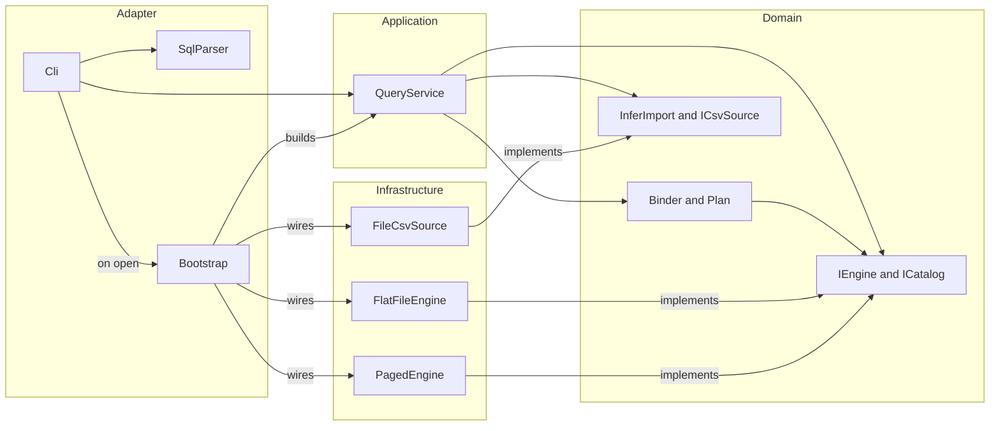

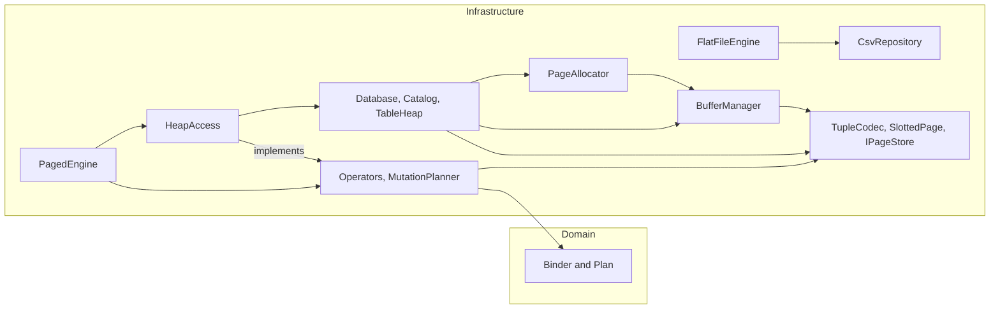

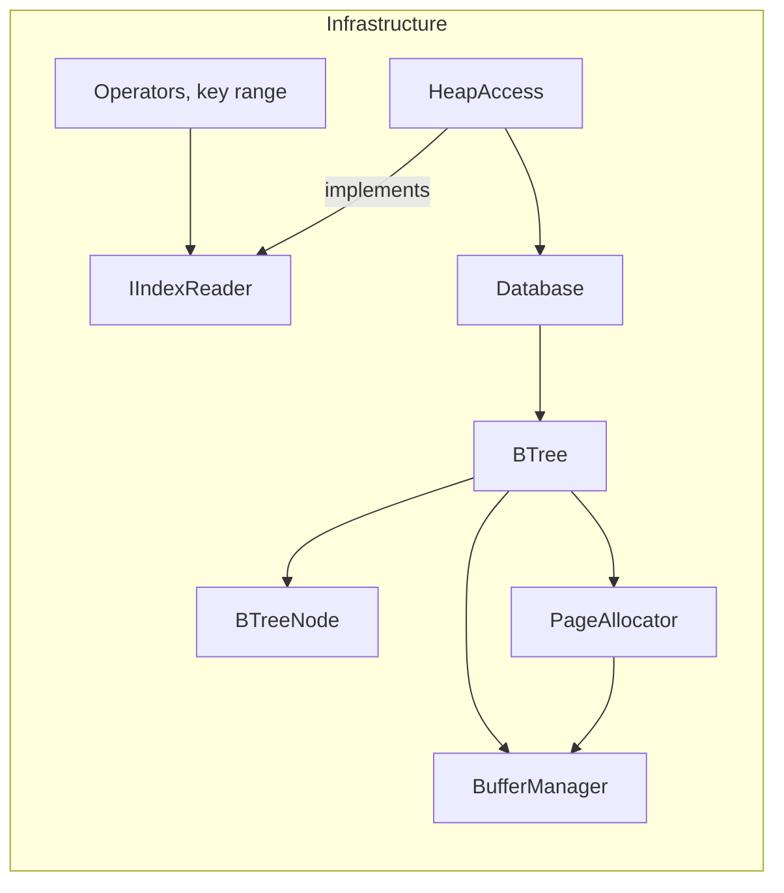

| Concern | Layer | Type |
|---|---|---|
| SQL parsing and statement splitting (`sql_parser.cpp`, `statement_buffer.cpp`) | Adapter | Pure |
| Terminal loop, commands, engine setting (`cli.cpp`, `repl.cpp`), composition root (`bootstrap.cpp`) | Adapter | Library-backed |
| One statement under the database-level reader-writer lock, the DB-level lock (`application.cpp`) | Application | Through `IEngine` |
| Values, syntax trees, plans, the Binder, expressions, import inference (`domain/`), engine port (`domain/engine.h`), index inspector port (`domain/index_inspector.h`) | Domain | Pure, interfaces |
| Directory lock, external CSV reading (`directory_lock.cpp`, `csv_file_source.cpp`) | Infrastructure | Library-backed |
| flatfile execution and CSV text (`flat_file_executor.cpp`, `csv_codec.cpp`) | Infrastructure | Pure |
| flatfile tables in memory, load and commit (`flat_file_engine.cpp`, `infrastructure.cpp`) | Infrastructure | Resource-aware |
| paged row layer: row streams, hash keys, operators, key range extraction, constraint checks (`paged/operators.cpp`, `paged/key_range.cpp`, `paged/mutation_planner.cpp`), and the index port `paged/index_reader.h` | Infrastructure | Pure, interface |
| paged engine, heap access, database, catalog, table heap, B+Tree, page allocator, buffer pool, page store (`paged/paged_engine.cpp`, `paged/btree.cpp`, `paged/page_allocator.cpp`, `paged/buffer_manager.cpp`) | Infrastructure | Resource-aware |
| paged byte layer, the B+Tree node algorithms with the invariant checker, and the Least Recently Used (LRU) and 2Q policies (`paged/slotted_page.cpp`, `paged/btree_node.cpp`, `paged/replacement_policy.cpp`) | Infrastructure | Pure |

Dependency direction: Domain includes no other layer. Application includes only Domain, and Infrastructure includes Domain and its own headers. `SqlParser` includes only Domain (ADR-0003). `Bootstrap` is the only component outside Infrastructure that includes Infrastructure headers, and `bootstrap.h` only forward-declares `paged::PagedEngine`. The two engines never include each other, and inside `paged/` the byte layer and the row layer include no resource-aware header. `tests/test_layering.cpp` checks these rules (ET-16, XU-32, PI-12).

Ownership: `Bootstrap` hands the engine to `QueryService` as a `std::unique_ptr<IEngine>`; flatfile owns its `CsvRepository`, and `PagedEngine` owns its `Database` and one `std::shared_ptr<void>` of the directory lock, declared before `Database` so the dirty pages are written out before the lock is released. `OpenedDatabase` holds the `QueryService` and another copy of the lock, and `Cli` owns the current one. `Database` owns `IPageStore`, `BufferManager`, `PageAllocator`, `Catalog` and the cached `TableHeap`s and `BTree`s through `std::unique_ptr` and destroys them in the order `BTree`, `TableHeap`, `Catalog`, `PageAllocator`, `BufferManager`, `IPageStore`; `Catalog`, every `TableHeap` and every `BTree` borrow the `PageAllocator`, and a `BTree` keeps no page between two calls. `PagedEngine` builds a `DatabaseTableReader` and a `DatabaseIndexReader` for each statement, both borrowing the `Database`, and implements `IIndexInspector` for `QueryService`, which borrows it for as long as the engine it owns lives. The engine borrows the plan for one `Execute`, and results are returned by value.

### 2.2 Types and Interfaces

The diagram shows the engine port, the two index interfaces and the storage interfaces with their implementations. `ICsvSource` (2.7), `ITableReader` and `IOperator` (2.13) are described where they are used, `BTree` is described in 2.17, and the exact signatures are in the headers named in 2.1.

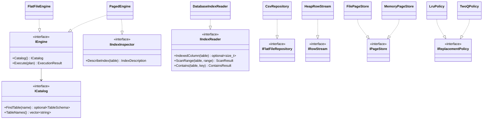

**Domain types:**

- `Value` is `std::variant<int64_t, double, std::string>`, with no NULL, and a `Row` is a `std::vector<Value>` in column order.
- `TableSchema`: name, `columns` (`ColumnDef`: name, `DataType` `kInt`, `kDouble` or `kText`, optional `default_value`), `primary_key_index`, `foreign_keys` and `unique_indexes` (non-key `UNIQUE` columns), both ascending by column position, and `auto_increment_index`.
- `ExecutionResult` is `ResultSet`, `AffectedRows`, `CommandComplete` (a tag such as `CREATE TABLE visitors`, and notes) or `ExecutionError` (`ErrorKind` `kBind`, `kUnsupported`, `kConstraintViolation`, `kRuntime` or `kIo`, and a message).
- `Statement` and `Expr` are the syntax tree; `PlanNode` (`ScanNode`, `FilterNode`, `JoinNode`, `AggregateNode`, `ProjectNode`, `SortNode`, `LimitNode`, the write nodes and the Data Definition Language (DDL) nodes, for `CREATE TABLE`, `ALTER TABLE` and `DROP TABLE`) refers to columns by position, and `BoundExpr` carries a static type, where `kBool` is not storable. `BoundAggregate` exists only inside the Binder; an `AggregateNode` outputs the group keys and then the aggregate values.

**Adapter and Application types:**

- `ParseError` holds the 1-based `column` of the offending token and a description.
- `OpenedDatabase` holds the `QueryService`, the normalized directory, the lock, `is_created`, the row counts and rejected lines of the tables, the engine kind, a borrowed `paged_engine` pointer and the `note:` lines.
- `QueryService` is neither copyable nor movable, and its `Execute`, `DescribeCatalog`, `DescribeIndex` and `ImportCsv` can run on several threads at once (2.14). `DescribeIndex(table)` returns an `IndexDescription` or an `ExecutionError`; it answers through the `IIndexInspector` that the engine provides, and for an engine that provides none it returns `kUnsupported` `the flatfile engine has no indexes`.
- `IndexDescription` (`domain/index_inspector.h`) holds the table, the indexed column, the height, the node count, the key count, at most 40 nodes in breadth-first order (level, page id, key count, first and last key, right sibling) and the text of the check result (3.6).

**Signatures of the functions that cross a layer:**

- `ParseStatement(text)` returns a `Statement` or a `ParseError`, for SQL only (text starting with `.` is a `ParseError`), and `Bind(statement, catalog)` a plan or an `ExecutionError` (2.4).
- `Evaluate` and `EvaluateCondition` evaluate a bound expression on a row, and `InferImport(request, lines, catalog)` builds an import (2.7); all three are pure.
- `QueryService::Execute(statement)` takes the DB-level lock, binds against `IEngine::Catalog()` and calls `IEngine::Execute(plan)`; `DescribeCatalog()` returns the schemas for `.tables` and `.schema`, and `ImportCsv(request)` reads through `ICsvSource::Read(path)`.
- `OpenFlatFileDatabase(directory, is_parallel, current)` and `OpenPagedDatabase(directory, current)` return an `OpenedDatabase` or a failure reason (3.1), and `DirectoryLock::Acquire(directory)` takes the directory lock (2.14).
- `Database::CreateTable(schema)`, `Database::AddColumn(table, column)` and `Database::DropTable(table)` change the catalog, the page chains and the index pages of the paged engine and return a `PageError` on failure (2.6, 3.4). `Database::Index(table)` returns the cached `BTree` of the table, opened with its heap, or a null pointer for a table without an index; it fails with `kNotFound`, `kCorrupt` and `kClosed` as `Database::Table` does. `Database::CheckIndex(table)` runs the invariants and the heap agreement check of 2.17 and returns the first violation as `kCorrupt`, or no value.

**Paged storage types:**

- `PageId` and `FrameId` are `uint32_t`, and a Record Identifier (`Rid`) is a page id and a slot id. Storage calls return `Status` or `PageResult<T>`, with a `PageError` of `kIo`, `kCorrupt`, `kNoSpace`, `kNoFrame`, `kNotFound`, `kTooLarge`, `kInvalidArgument`, `kAlreadyExists` or `kClosed`; no exceptions are used.
- `IPageStore` reads, writes and allocates whole pages and syncs; its page count is the file size divided by 4096, rounded down (2.15). `BufferManager` calls it under the pool mutex.
- `PageAllocator` hands out the pages of a database: the first page of the free list in the file header, or a new page at the end of the file when the list is empty. `Release` puts a page chain that no table owns on the list, and `ReleasePages` puts an explicit list of pages on it, which is how the pages of a tree are freed (2.10, 2.11, 2.17).
- `KeyRange` is a value type with an optional low and an optional high bound of INT keys and an inclusive flag for each. `IIndexReader` is the port through which the row layer reads an index: `IndexedColumn(table)` is the position of the indexed column, or no value when the table has no index; `ScanRange(table, range)` is an `IRowStream` of the rows with a key in the range, in ascending key order; `Contains(table, key)` tells whether such a row exists. Its `ContainsResult` is a `std::variant<bool, domain::ExecutionError>`, like `ScanResult`, because a page read can fail; the error is mapped as in 2.13 and ends the planning of the statement. `ITableReader` has no index method (ADR-0051).
- `BTree` is the index of one table: `Insert(key, rid)`, `Find(key)`, `Delete(key)`, `Replace(key, rid)`, `Scan(range)`, `Pages()`, `CheckInvariants()` and `Shape()` (2.17). Its functions return `Status` or `PageResult<T>`, and `Insert` returns `kAlreadyExists` for a key that is present, `Delete` and `Replace` `kNotFound` for one that is absent.
- `BufferStats` counts `hits`, `misses`, `evictions`, `dirty_writebacks`, `page_reads` and `page_writes`; every `FetchPage` is one hit or one miss.
- `DatabaseOptions` defaults to 256 frames and LRU. `MemoryPageStore::InjectFailure(operation, nth_call)` lets tests fail one call.

### 2.3 SQL Language Rules

The dialect is a small subset of standard SQL, case-insensitive, with an optional trailing `;` (ADR-0007, ADR-0019). `<items>` is a comma-separated list of `*` and `<expr> [AS <alias>]`, and `<n>` is a non-negative integer literal:

```text
SELECT <items> FROM <table> [[AS] <alias>] {JOIN <table> [[AS] <alias>] ON <expr>}
       [WHERE <expr>] [GROUP BY <expr>, ...] [ORDER BY <expr> [ASC|DESC], ...] [LIMIT <n> [OFFSET <n>]]
INSERT INTO <table> [(<column>, ...)] VALUES (<expr>, ...) {, (<expr>, ...)}
UPDATE <table> SET <column> = <expr>, ... [WHERE <expr>]
DELETE FROM <table> [WHERE <expr>]
CREATE TABLE <table> (<column> <type> {<constraint>}, ...)
ALTER TABLE <table> ADD [COLUMN] <column> <type> {<constraint>}
DROP TABLE <table>
```

Types are INT (also `INTEGER`, `BIGINT`), DOUBLE (`REAL`, `FLOAT`) and TEXT (`VARCHAR(<n>)`, `CHAR(<n>)` with a positive `n`, length not enforced). Column constraints are `PRIMARY KEY [AUTOINCREMENT]`, `UNIQUE`, `NOT NULL` (accepted, no effect), `DEFAULT <constant>` and `REFERENCES <table>(<column>)`, each at most once. Table-level constraints, `IF NOT EXISTS`, `DROP COLUMN`, `CREATE INDEX`, `NOT`, `IN`, `IS`, `BETWEEN`, `HAVING`, `DISTINCT`, `UNION`, subqueries, `INNER`, `LEFT`, `RIGHT`, `FULL`, `OUTER`, `CROSS` or `NATURAL` before `JOIN`, and `/* */` are syntax errors. Where the grammar expects another token, `NOT`, `IN`, `IS`, `BETWEEN`, `HAVING`, `DISTINCT`, `UNION` and the join words (`INNER`, `LEFT`, `RIGHT`, `FULL`, `OUTER`, `CROSS`, `NATURAL`) are reported as `<WORD> is not supported`, except that a join word directly after a table name and followed by `JOIN` is reported as `<WORD> JOIN is not supported` and a subquery as `subqueries are not supported`; elsewhere the grammar reads the word as a name (`SELECT DISTINCT a` takes `DISTINCT` as a column) and the error is `expected ..., found ...`. Any other statement is `unrecognized statement`.

Identifiers match `[A-Za-z_][A-Za-z0-9_]*`. The reserved words are `SELECT`, `FROM`, `WHERE`, `JOIN`, `ON`, `AS`, `GROUP`, `BY`, `ORDER`, `ASC`, `DESC`, `INSERT`, `INTO`, `VALUES`, `UPDATE`, `SET`, `DELETE`, `AND`, `OR`, `LIKE`, `LIMIT`, `OFFSET`, `COUNT`, `SUM` and `NULL`, which reports `NULL is not supported`; DDL keywords and function names are keywords only where the grammar places them. A number is `digits` (INT) or `digits.digits` (DOUBLE), and one out of range is a syntax error: an INT outside 64 bits, or a DOUBLE beyond the largest double or so small that it would round to 0 (subnormal values are kept). A string is in single quotes with `''` for a quote, `--` starts a comment, and outside literals U+00A0, U+3000 and U+2000 to U+200A count as whitespace. The operators are `=`, `<>`, `!=`, `<`, `<=`, `>`, `>=`, `LIKE`, `AND`, `OR`, `+`, `-`, `*`, `/` and `||`, from lowest to highest precedence `OR`, `AND`, comparisons and `LIKE`, `+ -`, `* /`, `||`, then a negative sign and parentheses, the arithmetic and `||` ones left-associative.

Values and expressions: INT and DOUBLE compare as DOUBLE, and TEXT compares bytewise; comparing TEXT with a number is a `kBind` error. `+ - * /` take numbers, two INTs give an INT, and INT division truncates toward 0. `||` joins two TEXT values, and a result longer than 16777216 bytes is the runtime error `result of || is longer than 16777216 bytes` (ADR-0058). `LIKE` takes TEXT and matches `%` and `_` per UTF-8 character, ASCII letters case-insensitively, with no `ESCAPE`, in O(n · m) for text length n and pattern length m. Comparisons do not chain, so `a = b = c` is a syntax error. An INT result outside 64 bits or a non-finite DOUBLE is `kRuntime` `numeric overflow`, and `division by zero` (a divisor of 0 or ±0.0), `cannot cast '<text>' to INT` or `DOUBLE`, `negative substring length` and `ROUND digits out of range` are `kRuntime` too. A condition (`kBool`) appears only in `WHERE`, `ON` and under `AND` and `OR`, a `WHERE` or `ON` that is not a condition is `kBind`, and an `UPDATE` or `DELETE` without `WHERE` affects every row.

Aggregates are `COUNT(*)`, `COUNT`, `SUM`, `AVG`, `MIN` and `MAX`; `COUNT` is INT, `SUM` keeps the type, `AVG` is DOUBLE, `MIN` and `MAX` keep the argument type, and `SUM` and `AVG` of TEXT are `kBind`. Without `GROUP BY` an aggregate query outputs one row: on empty input `COUNT` and `SUM` give 0, and `AVG`, `MIN` and `MAX` are `kRuntime` `<FN> over no rows`. With `GROUP BY`, empty input gives no row. The functions are `LOWER`, `UPPER` (ASCII), `LENGTH` (UTF-8 characters), `SUBSTR(s, start [, length])` (from 1), `TRIM` (spaces and Tabs), `ABS`, `ROUND(x [, digits])` (0 to 15 digits, half away from 0 on the stored binary value) and `CAST(x AS <type>)`. `LOWER`, `UPPER`, `TRIM` and `SUBSTR` return TEXT, `LENGTH` INT, `ABS` the argument type and `ROUND` DOUBLE; an invalid UTF-8 byte counts as one character, and an unknown `<name>(` is the syntax error `unknown function <name>`. `CAST` of TEXT reads `[+-]?[0-9]+` within 64 bits as INT and `[+-]?[0-9]+(.[0-9]+)?` with the range of a DOUBLE literal as DOUBLE.

The parser bounds hostile input: parentheses, function calls, aggregate arguments and unary minus signs (a negative literal included) may nest at most 100 levels, counting the expression of the clause itself as level 1, and the finished expression tree may be at most 500 levels deep. Either limit reports the syntax error `expression is nested too deeply`. A `SELECT` may have at most 64 `JOIN` clauses; the 65th reports the syntax error `too many JOINs: at most 64 are allowed` at its `JOIN` keyword (ADR-0011). The limit bounds the number of joins and not the size of their result: the flatfile engine builds each join as a list of rows, so a join of two tables of n and m rows without an equality condition holds up to n times m rows in memory (two tables of 3000 rows give 8,997,000 pairs of about 200 bytes each), and no limit stops it.

Without `ORDER BY` the row order is undefined; the sort is stable, and `LIMIT` and `OFFSET` apply after it. An output column is named by its alias, its declared column name or its text, and `*` expands to the columns in schema order. INT prints in decimal, DOUBLE in fixed-point with the fewest decimals that restore it and always a decimal point (exactly at or above 2^53), and TEXT as is. An omitted `INSERT` column takes its constant `DEFAULT` or the next auto-increment value, the greater of the current maximum and 0, plus 1 (ADR-0016). A multi-row `INSERT` is all or nothing and reports the first failing row, and a Binder error in a statement with several rows gets the prefix `row <k>: ` (ADR-0020).

The differential tests use SQLite as a reference (ADR-0047). The differences come from the absence of NULL, from strict typing and from a few choices of 2.3 and 2.4. The corpus marks each statement that shows one of them, and the harness checks that the statement still differs in the stated way:

| Area | Strata | SQLite |
|---|---|---|
| `SUM`, `AVG`, `MIN` and `MAX` over no rows | `SUM` gives 0; the other three are `kRuntime` | NULL |
| Division by zero | `kRuntime` | NULL |
| INT overflow of `+`, `-` and `*` | `kRuntime` `numeric overflow` | The result becomes a REAL |
| TEXT mixed with a number in a comparison or an operator | `kBind` | The value is converted |
| `CAST` of a text that is not a number | `kRuntime` | 0, or the leading digits |
| `ROUND` with negative digits, `SUBSTR` with a negative length | `kRuntime` | A result |
| `SUBSTR` with a negative start | Counts from the start | Counts from the end |
| A `WHERE` that is not a condition, or a condition in the SELECT list | `kBind` | Allowed |
| `ORDER BY` outside the SELECT list, a plain column beside an aggregate | `kBind` | Allowed, with the column of an arbitrary row |
| `LIMIT -1` | Syntax error | No limit |
| INT against DOUBLE above 2^53 | Both are compared as DOUBLE | Compared exactly |
| Text of a DOUBLE | Fixed-point, and `-0.0` keeps its sign | Scientific notation for large and small values, and `0.0` |
| `DROP TABLE` of a table that another table references | `kBind`, even when no row references it | An error only while rows reference it, and only with `PRAGMA foreign_keys = ON` |
| `ADD COLUMN` without `DEFAULT` | `kBind` | Allowed, and the existing rows get NULL |

### 2.4 Binder Rules

The Binder runs these checks in order and returns the first error, `kBind` unless noted; the `ORDER BY` keys, with their columns and aggregates, are resolved only at check 7:

1. The tables of `FROM` and `JOIN` exist, and each qualifier (alias, otherwise name) is unique.
2. `ON` references only the tables joined so far.
3. Each column exists and is unambiguous, and a table with an alias is qualified only by the alias.
4. The type rules of 2.3 hold, including the argument count and types of functions.
5. Aggregates appear only in the SELECT list, not nested; one in `ORDER BY` must equal a SELECT item.
6. In an aggregate query the SELECT items are group keys (matched by bound expression; an integer literal in `GROUP BY` is a constant key), aggregates, literals or expressions built from them, and `*` is refused.
7. An `ORDER BY` key is a 1-based position, a SELECT alias (before a column of the same name, the first one when aliases repeat), or an expression equal to a SELECT item.
8. `UPDATE` assigns existing, distinct columns, never the primary key (`kUnsupported`), with values of the column type, an INT also to a DOUBLE column.
9. `INSERT` names existing, distinct columns; an omitted column has `DEFAULT` or is auto-increment, otherwise `no value for column <column>`; each row has the right count of constant values, functions allowed, of the right type (`kRuntime` when a constant fails to evaluate).

`CREATE TABLE` is checked in order: (1) the name is not `catalog` (`table name catalog is reserved`) and not taken (`table <table> already exists`), case-insensitively; (2) column names are unique; (3) exactly one `PRIMARY KEY`; (4) no `DEFAULT` on the primary key, and `AUTOINCREMENT` only on an INT primary key; (5) each `DEFAULT` is a constant of the column type, an INT also for a DOUBLE column, with `kRuntime` when it fails to evaluate; (6) a `REFERENCES` target is another existing table and a primary key or `UNIQUE` column of the same type. `ALTER TABLE ADD COLUMN` needs (1) an existing table and a new column name, (2) no key, `UNIQUE`, `REFERENCES` or `AUTOINCREMENT`, and (3) a `DEFAULT` by step 5. `DROP TABLE` (1) needs an existing table that no other table references, or reports `table <table> is referenced by <child_table>.<column>` for the first reference in catalog and foreign key order.

Plan generation rules: a SELECT plan stacks `ScanNode`, a left-deep `JoinNode` in `FROM` order, `FilterNode`, `AggregateNode`, `ProjectNode`, `SortNode` and `LimitNode`, leaving out what the query does not need. `WHERE` is split at `AND`, and each term goes to the lowest node that has all its columns, a term without columns above the first scan, with terms at one node merged into one `FilterNode` whose predicate is a balanced `AND` tree in the original term order, so its depth grows with the logarithm of the number of terms and not with the number (a parenthesized `WHERE` of 100,000 terms passes the parser limits of 2.3, and as a chain it would make the evaluator and the plan destructor recurse 100,000 levels); `ON` is never pushed down (ADR-0009). `ScanNode` keeps the declared spelling, and each `InsertNode` row is in schema order with values converted to the column types, an omitted auto-increment column holding a placeholder.

### 2.5 Constraints

Foreign keys are declared in the schema (ADR-0006), and each engine enforces the rules below in its own pure `PlanMutation` (ADR-0039), cross-checked by 2.8. Updating a referenced column cascades, deleting a referenced row is refused (ADR-0002), and a primary key cannot be updated. A statement checks all its changes before it writes, so a failed check changes nothing.

`INSERT` checks rows in order, after computing the auto-increment value, and reports the first violation:

1. The engine can store the row (`kUnsupported`): on flatfile no TEXT contains `\r` or a line break, `flatfile engine cannot store a line break in <table>.<column>`; on paged the tuple is at most 4060 bytes, `paged engine cannot store a row longer than 4060 bytes in <table>`.
2. The primary key is not a duplicate, `duplicate key: <table>.<column>=<value>` (`kConstraintViolation`).
3. No `UNIQUE` value is a duplicate, by column position, with the same message.
4. Each foreign key value exists in its parent, in declaration order, `no matching row: <table>.<column>=<value> not found in <ref_table>.<ref_column>`.

The duplicate checks include the earlier rows of the statement. `UPDATE` evaluates assignments on the old row, checks 1 and 4 only for changed values, and treats a new `UNIQUE` value as a duplicate only when it equals another row or another changed row, so swapping two values is legal; an assignment of an equal value (`-0.0` equals `0.0`) leaves the cell untouched. A changed referenced value is rewritten in the referencing rows through one old-to-new map, one level deep, so A to B and B to C rewrites A to B. The rewrite does not continue into a table that references the rewritten column of a referencing table: its rows keep the old value and no error is reported, on both engines. `DELETE` searches the child tables in catalog and foreign key order and refuses a referenced row with `<table>.<primary_key>=<value> is referenced by <child_table>.<child_column>`. `AffectedRows` counts the rows selected by `WHERE`. When several rows violate, the reported one follows file or scan order (2.8).

### 2.6 Catalog and DDL

The catalog holds one `TableSchema` per table. `ICatalog::FindTable` matches names case-insensitively and returns a copy, and `TableNames` follows the creation order. The engines differ only in how they store and change it:

| Item | flatfile | paged |
|---|---|---|
| Storage | `catalog.csv`, one row per column (ADR-0013) | The system tables `sys_tables` and `sys_columns` in `paged.db` (ADR-0024, ADR-0032) |
| Load | Validated as a whole at `.open`; an invalid file fails the open | Validated by `Catalog::Load` at `.open` into an in-memory cache |
| Reserved names | `catalog`, refused by the Binder on both engines | Also names starting with `sys_`, refused by `Catalog::CreateTable` |
| `CREATE TABLE` | Adopts an existing `<table>.csv` (ADR-0014) or creates it, in one commit with `catalog.csv` | Writes the first page, the root page of the index when the primary key is an INT, and the system table rows, removing the rows on failure (3.4) |
| `ALTER TABLE ADD COLUMN` | Rewrites the table with the default, with `catalog.csv` | Copies the rows with the default into a new page chain and builds a new index beside it, then adds the `sys_columns` row and points `first_page` and `index_root` at the new pages (3.4, ADR-0045, ADR-0053) |
| `DROP TABLE` | Removes the table from `catalog.csv` and deletes its file | Deletes the `sys_columns` and `sys_tables` rows and puts the page chain and the index pages on the free list (3.4, ADR-0046, ADR-0054) |

The format of `catalog.csv`: the header `table,position,column,type,primary_key,unique,auto_increment,has_default,default,ref_table,ref_column`, then one row per column in table and position order, with `1` or `0` flags and the default written by its column type. The validation of `catalog.csv` rejects the whole file for a table or column name that is not an identifier (a letter or `_`, then letters, digits or `_`, as in a `CREATE TABLE` statement), a repeated table or column name, non-consecutive positions, an invalid type, not exactly one primary key, a key with a `unique` mark or a default, auto-increment off an INT primary key, a default that does not parse, a table named `catalog`, and a foreign key whose target is the table itself, missing, of another type, or neither a primary key nor `UNIQUE`.

The system tables have fixed schemas, with table numbers 1 and 2 (`kSysTablesId` and `kSysColumnsId`, with `kFirstUserTableId` 3 and `kFirstUserPage` 3 defined beside them, ADR-0055): `sys_tables(table_id, name, first_page, primary_key_index, auto_increment_index, index_root)` and `sys_columns(table_id, position, name, type, default_kind, default_text, is_unique, ref_table, ref_column)`. `index_root` is the page id of the root of the index of the table, and 0 means no index. A table has an index exactly when its primary key is an INT (ADR-0048); the system tables have none. In `sys_columns`, `type` is 0 INT, 1 DOUBLE or 2 TEXT, `default_kind` is 0 none, 1 INT, 2 DOUBLE or 3 TEXT, `-1` and the empty string mean absent, and `default_text` holds an INT in decimal, a DOUBLE as the 16 hexadecimal digits of its bits and a TEXT as is. The schema mapping rebuilds `columns` by `position`, the keys from `sys_tables`, and `unique_indexes` and `foreign_keys` from `is_unique` and `ref_table`. The load validation returns `kCorrupt`, naming the table and column, for a table id below 3 or repeated, a repeated name, an orphaned column row, a table without columns, a `first_page` beyond the file, an `index_root` that is nonzero for a primary key that is not an INT, zero for one that is, below 3 or beyond the file, non-contiguous positions, an out-of-range code or default, a key index without a column, a foreign key naming no table or its own, a missing or mistyped target column, or a target neither the primary key nor unique, or a `next_table_id` not above the largest id. The table creation checks of `CreateTable` refuse a name that is not an identifier, is taken or starts with `sys_`, case-insensitively (`kAlreadyExists` for a taken name, `kInvalidArgument` otherwise), a schema without columns, with repeated column names, with auto-increment off an INT column or with key positions out of range, and a schema whose `sys_tables` row or one of whose `sys_columns` rows would be longer than 4060 bytes, such as one with a long TEXT `DEFAULT`. That last check runs before any page is allocated and gives `kUnsupported` `column <column> of table <table> cannot be stored in the catalog: ...`, or `table <table> ...` for the `sys_tables` row. After the checks, `CreateTable` allocates the first page of the heap and then, for an INT primary key, formats the root of the index as an empty leaf (2.17), so a new database gives the first table the pages 3 and 4, and writes both page ids into the one `sys_tables` row. A mutex (the DDL mutex) serializes `CreateTable`, `CommitAddColumn` and `DropTable` of the catalog, and a `std::shared_mutex` guards the cache: `FindTable`, `TableNames` and `TableId` take it shared and the three changes exclusive.

Paged `ALTER TABLE ADD COLUMN` writes the table again, because a tuple has no column count and so a page chain holds tuples of one schema only (ADR-0045). For a table with an index it also builds a new tree beside the new chain, because every row gets a new `Rid` (ADR-0053). Before `Database::AddColumn` allocates a page, it lists the pages of the old tree with `BTree::Pages` (2.17), so that a damaged tree fails the statement before anything changes, and it checks that the new `sys_columns` row fits in a tuple, with the `kUnsupported` message of `CreateTable` (`column <column> of table <table> cannot be stored in the catalog: ...`), and it scans the table to check that every row still fits in 4060 bytes with the default appended, which is `kUnsupported` by 2.5 check 1; a failed check leaves every page unchanged. It then builds a new chain with the extended schema, inserting each row of the old chain with the default appended and, for a table with an index, inserting the key of the row with its new `Rid` into a new tree. The statement ends by adding the `sys_columns` row at the next position, pointing `first_page` and `index_root` of the `sys_tables` row at the new chain and the new tree in one row update, and putting the old chain and the pages of the old tree on the free list. The table keeps its `table_id`, so the pages of the new chain carry it. No key, `UNIQUE` or foreign key changes, and a foreign key of another table names its target column by position, so no other table is touched. The rewrite compacts the table and changes the `Rid` of every row, which is allowed because no `Rid` is kept across statements (ADR-0026).

Paged `DROP TABLE` lists the pages of the index (`BTree::Pages`, 2.17), deletes the `sys_columns` rows of the table and then its `sys_tables` row, and puts the page chain and the listed index pages on the free list (2.10, ADR-0046, ADR-0054). `table_id` is never reused, because `next_table_id` only grows, so a table created later under the same name gets a new id and takes its pages from the free list. The Binder checks that no table references the dropped one (2.4), and `Catalog::DropTable` checks it again and returns `kInvalidArgument`, because a catalog with a foreign key to a missing table fails `Load`. Both statements open the table's chain and its index first, so a table whose chain or index is corrupt cannot be altered or dropped; the error is the `corrupt:` one of 2.13.

Adopting an existing CSV (flatfile only): `CREATE TABLE` on a table whose `<table>.csv` exists parses it by the load rules of 2.9 without dropping repeated keys; the rows those rules reject are left out without a report, are not counted in `(adopted <n> rows)` and stay in the file until it is rewritten. The rows must satisfy the declared primary key, `UNIQUE` columns and foreign keys, or the result is `kConstraintViolation` `cannot adopt <table>.csv: ` plus the violation; a header mismatch or an unreadable file is `kIo`.

### 2.7 Import Rules

`.import <file.csv> [<table>] [--pk <column>] [--type <column>=<type>]... [--skip-bad-rows]` imports an external CSV as a new table on either engine (ADR-0021). `ICsvSource::Read` returns the lines, and the pure `InferImport` returns the `ImportPlan` (schema, converted rows, skipped rows) that the engine writes as one `ImportTableNode`.

- Source file: RFC 4180 fields per line (a quoted field spanning lines is malformed), with the trailing `\r`, blank lines and a leading UTF-8 Byte Order Mark (BOM) skipped; the first line is the header, and the file is never modified.
- Table and column names: the table defaults to the file name without its extension; names must be identifiers, not reserved words of 2.3, not repeated, and the table not `catalog` or existing. On paged a `sys_` name is refused at creation (2.6).
- Target file: on flatfile `<table>.csv` must not exist, since the write is `is_new_file` (2.9), or the import is `kIo` `<table>.csv already exists; use CREATE TABLE to adopt it`; `CREATE TABLE` adopts such a file instead.
- Type inference: only the rows that pass the field-count, quote and `--type` checks decide. A column is INT when every value is a canonical integer (`0` or `-?[1-9][0-9]*` within 64 bits), DOUBLE when every value is read and written as is through the output format of 2.3, and TEXT otherwise, including a blank cell and a file without data rows. `--type <column>=<type>` forces a type and accepts what `CAST` accepts; a missing or repeated column is `kBind`.
- Primary key: `--pk` names it, otherwise the INT column `id`, and without either the error is `no primary key: ...`; a repeated value, with `-0.0` repeating `0.0`, always fails and reports both line numbers.
- Bad row: a wrong field count, malformed quoting or a value that misses its `--type`, reported as `line <l>: ` plus `expected <k> fields, found <m>`, `malformed quoting` or `<column> '<value>' is not <type>`; it fails the import unless `--skip-bad-rows` skips and reports it. A table name taken from a file name that is not an identifier or is a reserved word gets `cannot derive a table name from '<name>'; give one: .import <file> <table>`. No constraint is inferred.
- Write: flatfile writes `<table>.csv` and `catalog.csv` in one commit and refuses a TEXT value with `\r` or a line break by 2.5 check 1. paged checks every tuple length first, then creates the table and inserts through `InsertRows`; an I/O failure midway removes the rows and keeps the empty table, which reaches the file with the next write-out or at close, and the message ends with `; table <name> was created`.
- Result: `OK IMPORT <table> (imported <n> rows)`, or `(imported <n> rows, skipped <m>)` and up to 10 lines `skipped line <l>: <reason>`, then `... and <k> more skipped`.

### 2.8 Engine Equivalence

The rules of 2.3 to 2.7 hold on both engines, each implementing them on its own (ADR-0039). Two engines are equivalent on a statement sequence when, after every statement, the result kind, the columns, the affected count, the tag and the error kind and message agree, the rows agree as a multiset (with `ORDER BY`, as a sequence of sort keys), and every table holds the same multiset of rows (ADR-0044). `LIMIT` is compared only under an `ORDER BY` that fixes the order. The known differences:

| Item | flatfile | paged | Reason |
|---|---|---|---|
| TEXT or a TEXT `DEFAULT` with `\r` or a line break | `kUnsupported` | Stored | CSV is line-based (ADR-0012) |
| A tuple above 4060 bytes | Stored | `kUnsupported` | No overflow page (ADR-0027) |
| Table name starting with `sys_` | Allowed | `kUnsupported` | System table namespace (ADR-0032) |
| The pages of a dropped table | The file is deleted | Stay in `paged.db` on the free list, and the file does not shrink | Reuse without moving live pages (ADR-0046) |
| Row order, rows cut by `LIMIT` and the row reported for a violation, without a fixing `ORDER BY` | File order | Page and slot order, or key order for an index scan | The order is undefined (2.3) |
| Errors in rows below `LIMIT` that are never read, and all errors below `LIMIT 0` | Reported | Not reported | Early termination (2.13, ADR-0036) |
| An error that the `WHERE` of a statement would raise on a row outside the key range of an index scan | Reported | Not reported | The range narrows the rows that are evaluated (2.13, ADR-0052) |
| The error reported among several `kRuntime` sources | File order, child plan first | Pull and scan order | Error order (2.13) |
| DOUBLE `SUM` and `AVG`, an INT sum near 64 bits | File order | Scan order | Addition order |
| `.import` failing midway | Nothing changes | An empty table remains (2.7) | No transactions |
| `CREATE TABLE` or `.import` when `<table>.csv` exists | Adopts it, or refuses the import | Ignores the file | paged keeps data in `paged.db` |
| `.open --parallel` | Loads in parallel | Ignored | No load phase |
| Files after an interrupted write | A leftover `.orig` or a partial row (2.15) | Some pages of the statement (2.15) | No WAL yet (ADR-0043) |

### 2.9 Flatfile Engine

`FlatFileEngine` holds the tables in a `TableStore` (a `std::map` by lowercase name and an `order` vector of the creation order) and is the only caller of `IFlatFileRepository` (`Load`, `InspectTable`, `Commit`, `AppendRows`). It persists a change first and replaces the tables in memory only after success. `RunQuery`, `PlanMutation` and `PlanSchemaChange` (`flat_file_executor.h`) are pure functions over `const TableStore&`; `RunQuery` joins left-deep and hashes each `JoinNode` on its first equality, with a `FilterNode` above a join merged into it (ADR-0011).

File layout: the directory holds `catalog.csv`, one `<table>.csv` per table, `.strata.lock`, and during a commit `<file>.temp` and `<file>.orig`; other files are ignored. In a table file the first non-blank line is the header (a line of only `\r` is blank), and fields follow RFC 4180. A TEXT value cannot contain `\r` or a line break, and a row whose only field is empty is written as `""` (ADR-0012). A write keeps the line break of the header line, and its text unless `ALTER TABLE ADD COLUMN` regenerates it; a new, missing or empty file gets the header from the schema and `\n`, as `catalog.csv` does.

The load-time rules (ADR-0004): a load fails as a whole, never returning partial data. A leftover `catalog.csv.orig`, or a `<table>.csv.orig` of a table in the catalog, fails it with `leftover <file>.orig`, because an interrupted commit can leave old and new files side by side, or no `catalog.csv` at all (ADR-0008). Without `catalog.csv` there are no tables, and an invalid `catalog.csv` (2.6) fails the load. Every table needs a readable `<table>.csv`, and a file with a non-blank line needs a header that matches its columns case-insensitively. A row with a wrong field count, a number that does not parse (a DOUBLE such as `1e-400` that underflows to 0 or `1e999` that overflows does not parse), a TEXT field with a `\r` in it (the one `\r` that ends a CRLF line is part of the line break) or an unterminated quote is rejected and reported by file line number (3.1); a repeated primary key, with `-0.0` repeating `0.0`, keeps the last row, and rows keep the file order. The load runs no `UNIQUE` or foreign key check, and rejected rows are not written back. With `--parallel` worker threads read the tables, and a worker that cannot be started leaves its tables to the loading thread, with the same result.

The write rules: `Commit` replaces files with a staged commit (3.3, ADR-0008). `AppendRows` writes all its rows at once (ADR-0020); on failure it truncates the file back or removes a file it created and returns `could not append to <table>.csv`, adding `; truncating back failed` or `; removing the new file failed` when that also fails. Before writing, `Commit` checks every target: unchanged since recorded, no leftover `.orig`, absent when marked `is_new_file` (`.import`, a `CREATE TABLE` without adoption), and otherwise a regular file the owner can write; `AppendRows` checks the name, the record, that no `.orig` is left over, and the file type. A failed check writes nothing. External modification (ADR-0022): the size and modification time of each file are recorded at load and on adoption, taken before the file is read so that a change during the read is caught; a write refuses a changed file with `<file name> changed on disk since it was loaded; run .open again`, and a successful write, or an append truncated back after a failure, updates the record.

### 2.10 Page and Tuple Format

`paged.db` is a sequence of 4096-byte pages; page `n` sits at offset `n * 4096`, and the page count is the file size divided by 4096. Integers are little-endian at fixed width, written byte by byte (ADR-0025). Every page starts with a 32-byte header:

| Offset | Width | Field | Description |
|---|---|---|---|
| 0 | 4 | `checksum` | CRC-32C of bytes `[4, 4096)` |
| 4 | 4 | `page_id` | The page's own number, to detect a misplaced write |
| 8 | 1 | `page_type` | 0 unformatted, 1 file header, 2 heap data, 3 free, 4 index node |
| 9 | 1 | `reserved` | 0 |
| 10 | 2 | `slot_count` | Length of the slot array; 0 on an index node |
| 12 | 2 | `free_end` | Start of the tuple area `[free_end, 4096)`; 0 on an index node |
| 14 | 2 | `dead_bytes` | Deleted bytes not yet reclaimed; 0 on an index node |
| 16 | 4 | `next_page_id` | Next page of the table or of the free list, `0xFFFFFFFF` at the end; the right sibling of an index leaf, `0xFFFFFFFF` on the rightmost leaf and on every internal node |
| 20 | 4 | `table_id` | The owning table, 0 on a free page |
| 24 | 8 | `lsn` | Log Sequence Number (LSN), 0 until the WAL exists |

A heap data page is a slotted page: from offset 32, each 4-byte slot (`offset`, `length`) points to one tuple, and tuples stack from the end of the page. A live slot has a length of at least 1, and a dead slot is `0, 0`. The largest tuple is `4096 - 32 - 4 = 4060` bytes (ADR-0027). Page 0 is the file header, whose fields are `magic` at offset 32 (8 bytes, `PAGEDDB` and `0x00`), then 4 bytes each of `format_version` (2) at 40, `page_size` (4096) at 44, `next_table_id` (3 when new) at 48, `sys_tables_first_page` (1) at 52 and `sys_columns_first_page` (2) at 56 and `free_list_head` (0) at 60. Bytes 64 to 4095 of page 0 are reserved and zero, so a later field whose zero means absent needs no new `format_version` (ADR-0046). Version 2 is the version that holds the index root in `sys_tables` (2.6, ADR-0048), and a file of another version is refused. The ids and pages of the system tables are the constants `kSysTablesId`, `kSysColumnsId`, `kSysTablesPage` and `kSysColumnsPage`, and the first table and the first page of a user are `kFirstUserTableId` and `kFirstUserPage`, both 3 (ADR-0055). A new database has three pages, the header and the first pages of the two system tables, 12288 bytes.

A free page has `page_type` 3, no slots (`slot_count` 0 and `free_end` 4096), `table_id` 0 and zero bytes elsewhere, and its `next_page_id` names the next free page, or is `0xFFFFFFFF` at the end of the list. `free_list_head` names the first free page. Page 0 is never free, so 0 means an empty list; a file written before the free list existed holds 0 there, which is why adding the list needed no new `format_version` (ADR-0046). `PageAllocator` is the only code that reads or writes the list (2.11). After `Catalog::Load`, `Database::Open` walks the list and returns `kCorrupt` for a page past the end of the file, a page visited twice, and a page whose `page_type` is not 3. A free page that a table's chain reaches fails the ownership check of 2.11 with `kCorrupt`, so a page that is both free and owned is reported by one of the two walks.

Three checks return `kCorrupt` with the page and the condition: `VerifyHeader` (CRC, page id, type 0 to 4, and for a heap or free page `32 + 4 * slot_count <= free_end <= 4096`, for an index node `slot_count`, `free_end` and `dead_bytes` equal to 0; an all-zero page passes) after every read; the slot bounds check (a live slot lies inside the tuple area) on every slot access; and `CheckStructure` (live lengths plus `dead_bytes` fill the tuple area, no overlap, dead slots zero) before every compaction. `SealChecksum` writes the checksum before each write-out. A frame and a file offset are multiples of 4096, so one page never crosses an operating system page, and reading the slot array touches only contiguous bytes from offset 32.

An index node (ADR-0049) keeps the common header and adds a node header and two arrays. A leaf holds `key_count` entries, at most 289, and an internal node `key_count` keys, at most 337, with `key_count + 1` children. Keys are signed 64-bit integers, a child is a page id, and a Rid is a page id and a slot id (4 and 2 bytes).

| Offset | Width | Field | Description |
|---|---|---|---|
| 32 | 2 | `level` | 0 on a leaf, and one more than its children on an internal node |
| 34 | 2 | `key_count` | Valid entries in the arrays |
| 36 | 12 | `reserved` | 0 |
| 48 | 8 × 289 | leaf `keys` | Ascending, unique |
| 2360 | 6 × 289 | leaf `rids` | The Rid of the row of each key |
| 48 | 8 × 337 | internal `keys` | Ascending, unique; key `i` separates child `i` (keys below it) from child `i + 1` (keys at or above it) |
| 2744 | 4 × 338 | `children` | Page ids, one level below |

The capacities fill the page: 4096 - 48 = 4048 bytes, a leaf entry takes 8 + 6 = 14 bytes, so 289 entries use 4046, and an internal node with n keys takes 8n + 4(n + 1) bytes, so n = 337 uses 4048. A frame is aligned to 4096 and the key array starts at 48, so every key is 8-byte aligned in its frame and no node crosses an operating system page. The keys sit apart from the Rids and children so that a binary search reads one contiguous run of 2312 bytes on a leaf, 18.1 lines of 128 bytes, with 16 keys to a line; the effect on search time is not measured. The half of each capacity rounded down, 144 keys on a leaf and 168 on an internal node, is the minimum occupancy that a later full delete needs. The constants exist and nothing checks them while delete is lazy (2.17).

A tuple encodes the columns in schema order with no separator and no NULL bitmap: INT as 8 bytes of two's complement, DOUBLE as its 8 IEEE 754 bytes, little-endian (so `-0.0` and `NaN` survive), and TEXT as a 2-byte length and the bytes. `Decode(Encode(row)) == row` for every valid row, with DOUBLE compared by bits.

### 2.11 Table Heap

A table heap is the page chain of one table from its `first_page` in `sys_tables`, which only `ALTER TABLE ADD COLUMN` changes (2.6). The free-space map, kept only in memory and rebuilt on open (ADR-0031), orders the pages by capacity in a `std::set`, so finding the smallest sufficient page is O(log P). The invariants (ADR-0026):

- `Insert` encodes first, so an encoding failure touches no page. It takes the page with the smallest sufficient capacity (`contiguous space + dead_bytes`, minus 4 when no dead slot can be reused), the lowest page id among equals, reuses the lowest dead slot, compacts when needed, and otherwise links a page from `PageAllocator` at the tail; the map is updated while the page is still latched. When the map overstates a page, the insert corrects the map and retries once, and a second `kNoSpace` is `kCorrupt`.
- Live slot numbers never change (compaction drops only trailing dead slots), and a deleted slot can be reused, so a `Rid` can name another row after a delete.
- `Update` never crosses pages; when the row no longer fits it returns `kNoSpace`, and the caller deletes and reinserts, which changes the `Rid`.
- Compaction runs `CheckStructure` first and leaves a failing page unchanged, so an `Update` on a corrupt page keeps the old row.
- `Scan` reads one page at a time under a shared latch and returns its rows after releasing it. Opening a table walks the chain and returns `kCorrupt` for a foreign page, a cycle, or a next page past the end of the file, `the page chain of table <table> leads past the end of the file: ...`.

Every page of a chain, the first one included, comes from `PageAllocator::Allocate`, and the caller formats it. `Allocate` pops the first page of the free list: it latches the file header and then that page, checks `page_type` 3 and a valid `next_page_id`, sets `free_list_head` to the next page and returns the page latched and still formatted as a free page, for the caller to format. A successor below page 3 is `kCorrupt`, because page 0 would read as the end of the list. When the list is empty it returns `BufferManager::NewPage()`, which extends the file. `Release(first_page)` takes a chain that no table owns: it reads the old head, formats each page of the chain as a free page linked to the next, links the last one to the old head and sets the head to `first_page`. A page that is not a heap page makes `Release` return `kCorrupt` before it formats that page, which also stops a chain that loops, since the second visit finds a free page. Pages 0 to 2, the file header and the first pages of the system tables, are never released: `first_page` below 3 is `kInvalidArgument`, and a chain that reaches one is `kCorrupt`. A failure part way leaves the pages already formatted unreachable from the list, which wastes them and corrupts nothing, because the head changes last. `ReleasePages(pages)` frees an explicit list instead of a chain, which is how the pages of a tree are freed, because a tree has no chain to follow (ADR-0054). Every page must be at or above page 3, inside the file, listed once and of type 2 or 4, or the call returns `kCorrupt` (`kInvalidArgument` for a page below 3) before it formats any page, because the list is known in advance and is validated whole; it then formats the pages as free pages linked in list order, links the last one to the old head and changes the head last, so a failure wastes pages as `Release` does. `Allocate` gives a free page to an index node as it does to a heap page, and the caller formats it.

The concurrency contract: one writer at a time, which the DB-level lock provides (2.14), with readers alongside; each page is consistent when read, with no snapshot across pages. Appending a page latches the chain tail, then the file header, then the new page, and a reader holds one latch at a time, so no wait cycle forms. `Release` holds one latch at a time.

### 2.12 Buffer Pool

`BufferManager` keeps a fixed number of frames, 4096-byte memory slots aligned to 4096, at least 4 (ADR-0028). A pin counts the users of a frame and keeps it from eviction, and a latch is the reader-writer lock on its bytes. The pool mutex protects the page table, the frame metadata (`page_id`, `pin_count`, `is_dirty`), the free list, the replacement policy and the counters, and its critical section also calls `IPageStore`. Each latch is aligned to 128 bytes so that two frames never share a cache line (ADR-0034).

`PageGuard` owns one pin and one latch: it pins inside the pool mutex, waits for the latch outside it, and on release drops the latch and then the pin, merging the dirty flag into the frame under the pool mutex. Only an exclusive guard may write the bytes or `MarkDirty`, which an `assert` checks. A guard is move-only (a moved-from guard releases nothing), released only by its own thread, and must not outlive its `BufferManager`; page bytes never leave it. The lock order is latch, then pool mutex, never the reverse, and a thread holds more than two latches only to append a page (three: the chain tail, the file header and the new page) or to split an index node (four: the parent, the node, the file header and the new page), so 4 frames run both (2.17, ADR-0050). A miss writes back the victim and reads the page inside the pool mutex, so misses serialize.

- `FetchPage`: a hit pins and records the access; a miss takes a free frame or a victim, writes a dirty victim back and verifies the read. It returns `kNoFrame` without waiting when nothing can be evicted. A failed write-back keeps the victim dirty, resident and evictable, and a failed read frees the frame without a pin.
- `NewPage` returns a new page latched exclusively and dirty, for the caller to format; a failure returns the frame to the free list.
- `WriteBackAll` pins each dirty frame and takes its shared latch before the pool mutex, writes it out without `Sync`, and stops at the first failure, leaving the frames already written clean; `FlushAll` adds `Sync`, which a failed write-back skips. Neither runs while the caller holds a guard or another write-out runs.

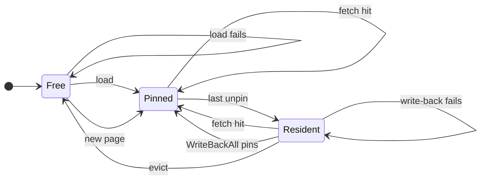

A `Pinned` frame cannot be evicted and a `Resident` one can; a dirty `Resident` frame is written back before eviction. The replacement policies are state machines that take no lock of their own and are called under the pool mutex (ADR-0029):

| Policy | Rule | Cost |
|---|---|---|
| `LruPolicy` | A list of the evictable frames; an access moves a frame to the tail, and `Evict` takes the head | O(1) |
| `TwoQPolicy` | First loads enter A1in, a First In First Out (FIFO) queue, where an access does not move a frame; a page whose id is in the ghost queue A1out (at most `N / 2` ids) enters Am, an LRU. `Evict` takes from A1in while it holds more than `N / 4` frames or Am has no candidate, recording the id in A1out, and otherwise takes the head of Am | `Evict` O(N), the rest O(1) |

2Q resists scans: a one-time scan fills only A1in and leaves the pages reused in Am, which LRU does not.

### 2.13 Paged Execution

`PagedEngine::Execute` dispatches on the plan node: a query becomes an operator tree pulled to the end, a write goes through `PlanMutation` and `ApplyChangeSet`, `CreateTableNode`, `AddColumnNode` and `DropTableNode` call `Database::CreateTable`, `AddColumn` and `DropTable` (3.4), and `ImportTableNode` follows 2.7. After a write or a DDL statement it writes out the dirty pages (2.15). `RowCounts()` scans every table for `.open`, so one unreadable table fails the open.

The row layer sees a table only through `ITableReader::Scan` and, for a table with an index, through `IIndexReader` (2.2, 2.17). Both return an `IRowStream` of `StoredRow` values (a `Rid` and a row) that returns nothing after an error, and the eight operators (`Scan`, `Filter`, `Project`, `HashJoin`, `NestedLoopJoin`, `Aggregate`, `Sort`, `Limit`) implement `IOperator` and are built by `BuildOperatorTree`; a join's `Columns()` are the left columns, then the right. Resource ownership: `Execute` owns the operator tree, an operator owns its children and borrows the plan, and a stream borrows its `TableHeap`. `AddColumn` and `DropTable` replace or destroy the `TableHeap` of their table, which is safe because they run under the exclusive lock (2.14), when no stream exists. Rows pass by value, a stream and an operator stay on the thread that made them, and no operator holds a `PageGuard` between two `Next` calls, so 4 frames run any plan and each concurrent reader needs one free frame for a heap read and two for an index descent, beyond which readers get `buffer pool exhausted: ...`.

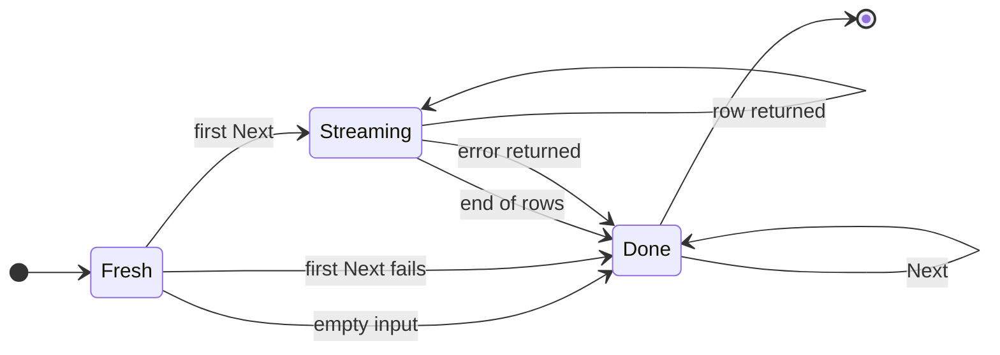

A blocking operator (Sort, Aggregate, the right side of a join) reads its child on the first `Next`, so building a tree reads no row. A `Done` operator returns nothing more and asks its child for nothing.

- `ScanNode` returns the rows in chain and slot order; `FilterNode` and `ProjectNode` evaluate per row.
- Index selection (ADR-0052): the plan and the Binder do not change. When `BuildOperatorTree` meets a `FilterNode` whose child is a `ScanNode`, and `IIndexReader::IndexedColumn` gives the position of the indexed column of that table, it calls `ExtractKeyRange(predicate, column)`. The function is pure and walks the top-level `AND` tree, in any nesting. It takes a conjunct that compares the column with an INT literal by `=`, `<`, `<=`, `>` or `>=`, the literal on either side (the operator flips when the literal is on the left), and skips every other conjunct: `<>`, `OR`, a DOUBLE or TEXT literal, and any expression, so `id + 0 = 5`, `ABS(id) = 5` and `id = 2 + 3` are full scans, while `id = -5` qualifies because the parser reads `-5` without a blank as a literal (2.3). The bounds of the taken conjuncts are intersected; bounds that cannot hold at once give an empty range, which still goes to `ScanRange`, and its stream ends at the first `Next` without reading a page. A predicate with no taken conjunct gives no range, and the scan is a full scan. With a range the scan reads `ScanRange`, in ascending key order, and the `FilterOperator` above it still evaluates the whole predicate on every row, so the rows returned are those of a full scan. A `FilterNode` above a join, a scan without a filter and a table without an index read through `Scan`. A range read of k rows costs O(log n + k) index accesses and k heap page fetches, which is more than a full scan when k is a large part of the table, and nothing chooses between the two (2.16).
- `JoinNode` hashes on the first conjunct of `ON` that equates a left and a right column (ADR-0011), buckets the right side by `JoinKey`, confirms a match with `ValuesEqual`, and otherwise loops; the other conjuncts are evaluated on each pair, and the output follows the left order and, within one left row, the right order. An empty right side still drains the left side.
- `AggregateNode` groups by the concatenated `ExactKey`, in order of first appearance; `SortNode` is a stable sort; `LimitNode` stops pulling after `limit` rows.

Hash key: `ExactKey` equals only for the same type and content, with `-0.0` equal to `0.0`; `JoinKey` encodes INT and DOUBLE as a double, so `2` and `2.0` meet. Early termination: rows below a `LIMIT` that are never pulled are never evaluated, and `LIMIT 0` pulls nothing, while flatfile computes the whole child plan first (2.8, ADR-0036). Error order: with several `kRuntime` sources the first in pull and scan order is reported, which can differ from flatfile, so the equivalence tests use statements with a single error source.

Write statements run in two phases (ADR-0038). `PlanMutation` only reads: `INSERT` scans the target once for its key sets, unless the primary key is indexed, the table has no `UNIQUE` column and no auto-increment value is generated, when each row costs one `Contains` call for the duplicate check (the current maximum that an auto-increment value needs is found by the scan, because a lazy delete can leave the rightmost leaves empty), and checks a foreign key by `Contains` on a parent whose referenced column is its indexed primary key and by a scan of the parent otherwise, each parent at most once; `UPDATE` reads the target to evaluate `WHERE` in a first pass, through `ScanRange` when `ExtractKeyRange` gives a range, and assigns in memory in a second, except that an `UPDATE` which assigns a `UNIQUE` or a referenced column reads the whole table, because its uniqueness check counts the rows that `WHERE` does not select; `DELETE` reads the target the same way and scans each referencing child. A range read hands the rows over in key order, so a statement that violates a rule on several rows reports the first one in key order, which 2.8 lists. The messages and the order of the checks are those of 2.5 on either path. It returns a `MutationPlan`, an ordered list of `TableChange`s whose updates and deletes carry the before-image, the row as it was. A cascade maps old to new values per referenced column (the first new value wins for an old value), scans each child once per foreign key, merges two rewrites of one row and checks the tuple length of the merged row, naming the child table. An empty change set writes nothing. `ApplyChangeSet` alone modifies pages and logs an undo entry after each action:

| Action | Execution | Index step, when the table has an index | Recorded after success |
|---|---|---|---|
| Insert | `TableHeap::Insert(row)` | `BTree::Insert(key, rid)` | `Inserted(rid)` |
| Delete | `TableHeap::Delete(rid)` | `BTree::Delete(key)` | `Deleted(old_row)` |
| Update in place | `TableHeap::Update(rid, new_row)` | None while the key is unchanged, and the `Rid` is kept; a changed key is described below | `Updated(rid, old_row)` |
| Update that returns `kNoSpace` | `Delete`, then `Insert` | `BTree::Replace(key, new_rid)` | Both entries |

The heap step and the index step of one action run in one internal helper of `heap_access.cpp` that pairs the `TableHeap` and the `BTree` of the table (ADR-0053). When the index step fails after the heap step succeeded, the helper undoes the heap step before it returns the error, and the entry is not recorded. In that undo a heap delete is undone by inserting the row again and, when the key is still in the index, by `BTree::Replace` to the new `Rid`; a key that is missing is not added, because a missing key is the damage that the statement reports and `CheckIndex` still names it. A `kNotFound` from `BTree::Delete` or `BTree::Replace` means that the index disagrees with the heap, and it is reported as `corrupt: index of <table> has no entry for key <key>`, and a `kAlreadyExists` from `BTree::Insert` as `corrupt: index of <table> already has an entry for key <key>` (a table with a `UNIQUE` column checks duplicates by scanning, so a stale entry meets the insert). A lookup by key cannot tell a row with no entry from an absent key: a keyed `SELECT`, `UPDATE` or `DELETE` does not find the row, and an `INSERT` of that key succeeds; only `CheckIndex` notices (2.17). Every place where a `Rid` changes is paired with an index step: the relocation of an update and the undo of a delete go through the helper, and the rewrite of `ALTER TABLE ADD COLUMN` (2.6) does the same pairing inside `Database::AddColumn`, which inserts into its new chain and its new tree and has no row-level undo, because a failure releases both. An action records the heap entries of the table above (one, and two for a relocated update), and no undo entry belongs to the index alone. Each entry carries the primary key of its row, taken when the action ran, so no undo step reads a page to find it, and the undo goes through the helper: undoing `Inserted(rid)` deletes the row and its key, and undoing `Deleted(old_row)` inserts the row and `BTree::Insert`s its key at the new `Rid`. A relocated update leaves its key pointing at the new `Rid`, so its two entries undo as an insert and a delete would: the undo of `Inserted(rid)` deletes the key and the undo of `Deleted(old_row)` inserts it again. The planner keeps the keys of the earlier rows of the statement in a set as it does now, so a duplicate inside one `INSERT` is found on the `Contains` path as well. Compaction does not change a `Rid`. A delete removes only the key from its leaf (2.17).

A direct `UPDATE` never changes a primary key (2.4), but a cascade can, when the foreign key column of a child is also its primary key (`id INT PRIMARY KEY REFERENCES parent(code)`). `ApplyChangeSet` then runs the updates of one `TableChange` whose key changes as deletes and inserts through the helper, in two sweeps, because a cascade can move keys in a chain (A to B and B to C, 2.5) and an insert of B must not meet the row whose B is about to become C. The first sweep deletes every such row with its old key (`Deleted(old_row)` entries); the second inserts the rows with their new keys (`Inserted(rid)` entries), so these rows get new `Rid`s, which the index records as any insert does. The undo runs the entries in reverse, so it deletes the inserted rows before it puts the deleted rows back, and a step never meets a key that a later undo step is about to free.

Rollback invariants: on a failure the entries are undone in reverse through the same helper (`Delete`, `Insert`, or `Update`, falling back to `Delete` plus `Insert` because an earlier undo may have taken the freed space; the index follows each step), a relocated update is restored through its `Deleted` entry, and the original error returns; when an undo step fails the rest still run, the message gets `; rollback failed: <message>` from the first failed step, and the table may contain partial changes. The undo restores the rows but not their `Rid`s; no row layer or heap code keeps a `Rid` across statements (ADR-0026), and the index, which does, follows every undo step. It is not a transaction (2.15). `InsertRows` applies the same undo.

Error mapping (`ToExecutionError`): `kIo`, `kNoSpace` become `kIo` unchanged; `kCorrupt` becomes `kIo` `corrupt: ...`; `kNoFrame` becomes `kIo` `buffer pool exhausted: ...`; `kClosed` becomes `kIo` `database is closed`; `kNotFound` becomes `kBind` `unknown table: <name>` for a table the catalog lacks, otherwise `kIo` `internal error: ...`; `kTooLarge` becomes the `kUnsupported` message of 2.5; `kInvalidArgument` from `CreateTable` or `AddColumn` becomes `kUnsupported`, otherwise `internal error`; `kAlreadyExists` from `CreateTable` becomes `kBind` `table <name> already exists`, otherwise `internal error`.

### 2.14 Concurrency

Across processes, `DirectoryLock::Acquire` takes an exclusive `flock` on `.strata.lock`, and a second process gets `database is locked by another process` (ADR-0015). When `.strata.lock` cannot be created because the directory is not writable (`EACCES`, `EROFS`), flatfile opens without the lock and paged returns `directory is not writable`, because it must write `paged.db`. Without the lock a flatfile process cannot commit, since a commit creates files in the directory, but an `INSERT` still appends to a table file that the process may write, and only the change check of ADR-0022 guards that append; an existing lock file that cannot be opened for writing is opened read-only and locked as usual.

Within a process, one `std::shared_mutex` in `QueryService`, the DB-level lock, guards the data of either engine (ADR-0040). `SELECT`, `DescribeCatalog` and `DescribeIndex` take it shared; every other statement and `ImportCsv` take it exclusive, before anything else. It covers bind and execute together, so a statement sees the schema it was bound to, and it prevents data races, lost updates and stale column positions. Readers run in parallel: flatfile over `const TableStore&`, paged with local state and thread-safe members. The B+Tree has its own latch protocol, which keeps a reader from seeing a half-split node when a writer runs beside it (2.17); the DB-level lock already keeps writers and readers apart at the engine level, so that protocol is exercised directly by the storage tests. Disk I/O happens under the lock, so readers wait for a writer's I/O.

The locks of the system are always taken in this order: (1) the directory lock, (2) the DB-level lock, (3) the table heap cache mutex of `Database`, (4) the DDL mutex and then the cache lock of `Catalog`, (5) a frame latch, at most four, taken for a heap append in the order chain tail, file header, allocated page, and for an index in the order of its nodes from the root toward the leaf (a higher level before a lower one), then the file header, then the allocated page (2.17); a thread never holds a heap page and an index node together, because the helper of 2.13 finishes the heap step before the index step, (6) the pool mutex. Code holding a later lock never takes an earlier one. `Database::AddColumn` and `DropTable` hold the table heap cache mutex across their page I/O, which no reader meets, because both statements run under the exclusive DB-level lock. The `Flush` before a same-directory reopen takes no `QueryService` lock and relies on the single-threaded CLI. Reader-writer fairness is not measured.

### 2.15 Durability and Failure Handling

In both engines a rejected statement changes nothing and a successful one has reached the operating system (OS) before it returns. Neither calls `fsync` per statement (ADR-0008, ADR-0043), so a completed statement survives Ctrl-C or `kill` but not an OS crash or power loss, and neither has crash consistency; the WAL planned for paged adds it there.

| Item | flatfile | paged |
|---|---|---|
| Durability | Each write rewrites or appends files | `WriteBackAll` after every `INSERT`, `UPDATE` or `DELETE` with a change set and after a successful `CREATE TABLE`, `ALTER TABLE`, `DROP TABLE` or `.import`; `Close`, the destructor and `Flush` also `Sync` (`F_FULLFSYNC` on Apple, `fsync` elsewhere) |
| Statement atomicity | Checks before writing; commits and appends are all or nothing | A failed check modifies no page; a failed apply is undone (2.13), and so is a failed step of `ALTER TABLE` or `DROP TABLE` (3.4) |
| Write-out failure | Files are restored (3.3) | `kIo` `<message>; statement was applied but not saved`; the dirty pages stay for the next write-out |
| Interrupted write | A leftover `.orig` fails the next load and blocks every later write to that file (a leftover `catalog.csv.orig` blocks every DDL statement and `.import`); an interrupted append leaves a partial row | A multi-page statement can leave some of its pages, and `ALTER TABLE` or `DROP TABLE` can also leave pages that no table and no free list owns, or a table whose columns and tuples disagree, which a scan reports as `corrupt`, or an index whose entries disagree with its heap, which a lookup that meets the damage reports as `corrupt` and `.dump index` reports in its check line; the CRC, `Load`, the free list walk and the index check detect damage, nothing repairs it |
| Damaged data at open | The load fails as a whole | `error: could not open <directory>: corrupt: <message>`, and the current database stays |
| Damaged data after open | A changed file is refused (2.9) | A page of the heap or of the index failing `VerifyHeader`, or an index entry that names no row, fails the reads that meet it and no other table (2.17) |
| Unwritable directory | Opens without a lock | Refuses to open (2.14) |
| Reopening the same directory | Reloads the files | `Flush` first, so the new `Database` reads current pages; a failed flush aborts the open |
| Memory | Every row | Sorts, aggregates, join builds, key sets; no result is claimed for data larger than memory |

The file rules of paged: a file size that is not a multiple of 4096 is `kCorrupt` unless the extra bytes are all zero, the remains of an extension stopped by, for example, `SIGXFSZ`, which are ignored. A file of 0 bytes, or of fewer than 4096 bytes that are all zero, is a new database, and one of fewer than 3 pages is `kCorrupt`, as is a mismatched `magic`, `format_version` (a file of version 1 is refused with `format_version 1 is not supported (expected 2)`), `page_size` or header page. A second `Close` succeeds, a failed `Close` leaves the database open and can be retried, after `Close` the table calls return `kClosed`. An I/O failure is `kIo` with the file or page and `errno`. The file never shrinks: the pages of a dropped table are reused, not returned to the file system. A first creation that is interrupted before its three pages are written leaves a file that the next `Open` refuses with `kCorrupt` (for example `size of 2 pages is below the minimum of 3`); the file holds no user data, and deleting `paged.db` and opening the directory again creates the database anew. Two limitations remain: replacing a paged database whose pages cannot be written prints `paged: failed to write the database on destruction: <message>` and loses them, and a directory deleted while open is recreated with a stale lock.

### 2.16 Costs

For n rows scanned, m on the other side, t tables, u `UNIQUE` columns, g groups, k inserted rows, P pages, F free pages, c child rows of a cascade, h the height of an index, I the pages of an index and r the rows of a key range:

| Operation | flatfile | paged |
|---|---|---|
| Table lookup | O(log t), `std::map` | O(1), `std::unordered_map`, plus a copy of the schema |
| Scan | O(n), copying rows | O(n) decodes, one page of rows in memory |
| Hash join | O(n + m), output held | O(n + m), O(m) memory, output streamed |
| Join without equality | O(n · m) | O(n · m) |
| Aggregate, sort | O(n), O(n log n) | O(n) with O(g) memory, O(n log n) |
| `INSERT` | O((1 + u) · n + k · m) | O(n + k + m), each parent scanned once |
| `UPDATE`, `DELETE` | O(n + m) | O(n + m + c) |
| `ALTER TABLE ADD COLUMN` | O(n + t), rewrites the table and `catalog.csv` | Two scans of the n rows, one to check and one to copy into a new chain, plus O(n · h) to build a new index, then O(P + I) to free the old pages |
| `DROP TABLE` | O(t), rewrites `catalog.csv` and deletes a file | O(P) to open the chain and O(P) to free it, O(I) to list and free the index pages, and a scan of the catalog rows |
| Point lookup by an indexed key | None | O(h) index pages and one heap page |
| Range of r indexed keys | None | O(h + r) page accesses: between ceil(r / 289) and ceil(r / 144) + 1 leaves, and one heap page fetch per row; leaves that deletes have emptied or thinned add one access each; a range that ends below the separator of its first leaf, a one-key range included, adds none |
| `INSERT` with an indexed key, no `UNIQUE` column, no generated key and indexed parents | None | O(k · h), a `Contains` per row and per foreign key |
| Index insert, delete | None | O(h) page accesses; an insert splits a node in O(1) page writes, a root split writes three pages, and page 0 when they come from the free list; a delete merges nothing |
| Index check, `.dump index` | None | O(n · h): the shape walk and the check each read every node, and the check looks up every row |
| Page allocation | None | O(1) from the free list or from the end of the file |
| Open | O(n), parallel with `--parallel` | Scans every table, O(P) per chain, and walks the free list, O(F); the root of an index is checked on first use, O(1) |

A tree of height 1 holds at most 289 rows, one of height 2 at most 338 × 289 = 97,682, and one of height 3 at most 338 × 338 × 289 = 33,016,516, when every node is full. A leaf made by a split holds at least 144 keys, so 30,000 rows need between 104 and 209 leaves under one root, a height of 2 (ADR-0049). Without an index, which is flatfile, and paged for a table whose primary key is TEXT, point lookups and constraint checks are full scans. On paged a `UNIQUE` column and a foreign key column have no index, so a check on them scans, and a `DELETE` of a referenced row scans each referencing child.

### 2.17 B+Tree Index

A table whose primary key is an INT has one B+Tree on that key, and an entry is a key with the `Rid` of its row (ADR-0048). Keys are unique, because the primary key is. The node layout is in 2.10. The pure part is `paged/btree_node.cpp`: functions over the bytes of one page and a capacity, which never see a page handle, a pin or a latch, and the invariant checker `CheckTree`, which reads nodes through the interface `INodeSource` (one function, `ReadNode(page_id)`, that returns a copy of a node). `BTree` (`paged/btree.cpp`) is resource-aware: it fetches nodes through `BufferManager`, takes pages from `PageAllocator`, and calls the pure functions on the frame bytes. It holds a reference to each, the table id, the root page id and the capacities, and no page between two calls.

Terms of this section. A B+Tree is a search tree whose nodes are pages. A leaf holds entries in key order, and the leaves are chained from left to right through `next_page_id`. An internal node holds separator keys and child page ids, and a separator tells which child covers which range of keys. The level of a leaf is 0 and the level of its parent is 1, and so on up to the root. The height is the level of the root plus one, which is the number of pages a lookup reads, so a tree that is a single leaf has height 1. A split divides a full node into two and gives the parent a separator for the new node. A latch is the reader-writer lock on one frame, and a pin keeps a frame in the pool (2.12).

**Node algorithms.** `FormatLeaf` and `FormatInternal` write an empty node, `LeafSearch` is a lower-bound binary search that returns a position and whether the key is there, `LeafInsertAt` (refused on a full leaf, which `BTree` never asks) and `LeafRemoveAt` shift the keys and the `Rid`s after a position, `InternalChildIndex` returns the number of keys at or below the search key, so that a key equal to a separator goes to the right child, `InternalInsertAt` adds a separator and the child on its right, `SplitLeaf` and `SplitInternal` move the upper half of a full node into an empty one, and `CheckNode` checks one node. `SplitLeaf` leaves 145 keys on the left of a full leaf of 289 and moves 144 to the right, links the right node to the old right sibling of the left one and the left node to the right one (the right node is already formatted, so its header holds the page id for the link), and returns the first key of the right node as the separator, which stays in the leaf. `SplitInternal` leaves 168 keys and 169 children on the left of a full node of 337 keys, returns the middle key, which leaves the node, and moves 168 keys and 169 children to the right. For a capacity C, `SplitLeaf` leaves ceil(C / 2) keys on the left and moves floor(C / 2) to the right, and `SplitInternal` leaves floor((C - 1) / 2) keys on the left, returns the next key and moves the other C - floor((C - 1) / 2) - 1 to the right, so that every half keeps at least 1 key. The capacities are arguments with the layout maximum, 289 and 337, as the default; `BTreeOptions` may lower them, to at least 2 for a leaf and 3 for an internal node, so that a test reaches a tree of height 4 without a million keys. A larger value is `kInvalidArgument`. The options are not stored in the file, which is always read with the defaults, and a node holds at most its capacity of the options it was built with. `BTree::Create(buffer, allocator, table_id, options)` allocates the root, formats it as an empty leaf and returns the tree; `BTree::Open(buffer, allocator, table_id, root, options)` checks the root and returns the tree; both return a `PageResult<BTree>` and take the default `BTreeOptions` when none is given. `Database` always uses the defaults, and a test that needs small capacities builds the tree directly over a `BufferManager` and a `PageAllocator`.

**Invariants** (`CheckTree` reports the first violation as `kCorrupt` naming the page and the rule):

1. Every node has page type 4, the table id of the tree and its own page id, `key_count` at most its capacity, and its heap header fields zero.
2. The root has a level below 40 (an internal node has at least 2 children and a file has at most 2^32 pages, so a valid tree has fewer than 33 levels; the limit stops a loop and rejects no valid tree, the one built with the small capacities of `BTreeOptions` included), and every child of a node of level L has level L - 1, so all leaves are at level 0 and the height is the same on every path.
3. Keys increase strictly within a node.
4. Every key of child `i` of an internal node is below key `i` and, for `i` above 0, at or above key `i - 1`.
5. Following `next_page_id` from the leftmost leaf visits every leaf once, in the order of a left-to-right walk of the tree, and ends at `0xFFFFFFFF`. An internal node has `0xFFFFFFFF`.
6. No page is reached twice, so the structure is a tree.
7. An internal node has at least one key.

The minimum occupancy of 144 and 168 keys is not checked, because a lazy delete lets a leaf fall below it. `BTree::CheckInvariants` is `CheckTree` over a source that copies a node under a shared latch. The agreement of the index with its heap, that every row of the heap has an entry with its key and its `Rid` and that the entry count equals the row count, is checked by `Database::CheckIndex(table)`, which `.dump index` calls (3.6).

**Insert** (3.8). The writer takes the exclusive latch of the root. A full root is split in place. The writer allocates two pages, formats each as an empty node of the root's kind and level, and drops their guards, one page at a time, so that it never holds a new page while it calls `Allocate` or `ReleasePages` again. It then latches both exclusively, applies `SplitLeaf` or `SplitInternal` from the root into the right page, copies what is left in the root into the left page (the keys, the Rids or the children, the level, and for a leaf the link to the right page), and formats the root as an internal node of one key, the separator, and two children, the left page and the right page, one level higher. The root page keeps its page id, and the left page is the new leftmost leaf of a tree that was one leaf. The writer then holds the root, the left page and the right page; it picks the half that the key enters with `InternalChildIndex` on the new root, releases the root and the other half, and goes on with the kept half as the current node, which is half empty, so a root split never leaves 5 latches held. Then the writer repeats at the current node, which is latched exclusively and not full: on an internal node it picks the child by `InternalChildIndex` and latches it; when the child is full it allocates a new right sibling, splits the child into it, inserts the separator into the current node, which has room, and goes on with the child or the sibling according to the key; the latch of the current node is released when the next node is latched, or when the separator of a split is written. At a leaf, which is not full, `LeafSearch` finds the key: a present key is `kAlreadyExists`, otherwise `LeafInsertAt` adds it. The fetch of a node and `Allocate` are the only steps that can fail, and all of them come before the first byte of the nodes they concern changes; in a root split a failure of the second `Allocate`, or of the fetch of either new page, releases the new pages that exist, each already an empty node of type 4 and held by no guard, with `ReleasePages` as a best effort, and the root is unchanged because it is rewritten only after both pages are latched. After a split the latch of the half that the key does not enter is released together with the parent. A failed insert leaves a valid tree, with at most the splits that were already done.

**Split protocol** (ADR-0050). A reader reaches a node through its parent or through the `next_page_id` of its left neighbor, and takes the shared latch of the child before it lets go of the parent. A writer that splits a node holds the exclusive latch of that node and of its parent until the new sibling, the sibling link and the separator are written, so a reader sees the node before the split or after it, and never between. A reader already in a leaf delays the writer at that leaf's latch. Tree latches are taken from the root toward the leaf, and from left to right along the leaves, by every thread; the file header and the new page come last. So there is no wait cycle: a reader holds at most two latches (a parent and its child during a descent, one while it copies a leaf), and a writer holds at most four (the parent, the node, the file header, the new page).

**Delete and Replace.** Both descend with shared latches and take the exclusive latch of the leaf only, because neither changes the structure. The level of a node is known only once its latch is held, so the descent latches a child exclusively when its parent has level 1. A root that is a leaf is latched shared first, read as level 0, released and latched exclusively; nothing can split it in between, because the tree has one writer at a time (ADR-0050). `Delete` removes the key with `LeafRemoveAt`, and `kNotFound` reports an absent key. A leaf may become empty. It stays in the tree and in the leaf chain, and no node is merged, redistributed or freed, so the height never falls and the separators of the parents stay valid, as they only bound ranges. `Replace` overwrites the `Rid` of a present key. The space of deleted keys returns when a later insert uses it, and the whole index when `DROP TABLE` frees it or `ADD COLUMN` builds a new one.

**Scan.** `Scan(range)` reads no page. The first `Next` finds the leaf for the low bound by the shared descent, or the leftmost leaf without one. Each `Next` that has run out of entries latches the current leaf shared, copies the entries of the range into a buffer, reads `next_page_id`, releases the latch and returns the entries one by one; it ends at the first key above the high bound, at the end of the chain, just after it has returned a key equal to an inclusive high bound, because keys are unique and the next leaf cannot hold more of the range, or after the leaf of the low bound when the high bound is below the separator that bounds that leaf from above, because every key of a later leaf is at or above that separator (the descent records it); so a lookup of one key, present or absent, reads one leaf and never the next one, however many empty leaves follow. A range that reaches past that leaf has no such bound for the leaves after it, and reads each of them, empty ones included, until a key above its high bound or the end of the chain. No latch and no pin is held between two `Next` calls, so a scan holds 2 frames during its descent and 1 while it copies a leaf, and 4 frames run any plan (2.13). A scan sees each leaf as it was when it read it, with no snapshot across leaves, as `HeapScan` does. A leaf chain longer than the page count of the file is `kCorrupt`, which stops a loop. The `IRowStream` of `ScanRange` fetches the row of each entry with `TableHeap::Get(rid)`; a `Rid` that names no live row, or a row whose primary key differs from the key of the entry, is `kCorrupt`, reported as `corrupt: index of <table> names no row <page>:<slot>` or `corrupt: index of <table> disagrees with its row <page>:<slot>`; the stream maps the `kNotFound` of a dead slot, a slot out of range or a page past the end of the file, and the `kInvalidArgument` of a page that is not a heap page of the table, which `TableHeap::Get` returns, to the first of the two. `Find` returns no value for an absent key, and `Contains` reads no heap page, so an entry that names no row is not noticed by it; `CheckIndex` and a scan notice it.

**Damaged nodes.** Every fetch of a node by `BTree` checks the part of `CheckNode` that costs O(1) before it reads the arrays: the page type, the owner table, its own page id, the level that the parent or the root implies, and `key_count` within the capacity. A node that fails is `kCorrupt`, so a damaged `key_count` never reads past the arrays. `Pages()` makes this check on every node of its walk. `CheckInvariants` and `CheckIndex` run the whole of 2.17, and only they see a key out of order, a broken leaf chain, an entry that names no row or another row's key.

**Pins.** Every node is held by a local `PageGuard`, so each pin and latch is released on every path, early returns and errors included. A pin ends when the step that needed it ends: the parent when the child is latched or the separator is written, a node at the return of `Find` once the 6-byte `Rid` is copied, and a leaf at the copy of its entries in a scan. Nothing holds a pin across a call to the heap or across a `Next` call.

**Pages.** `Pages()` walks the tree depth first under shared latches, one at a time, and returns every page id, failing as `CheckTree` does on a repeated page, a foreign page or a wrong level. `Shape()` walks the tree breadth first, reading each node once, and returns the description that `.dump index` prints. On a tree that fails the walk, `Shape` returns the nodes it read, and `DescribeIndex` puts the first violation in the check line; it returns an error only when the root cannot be opened.

**Interaction with the planned WAL.** Every change to a node is a write through an exclusive `PageGuard` followed by `MarkDirty`, a node keeps no state outside its page, and the root page id does not change, so a log of the after-images of the pages that a statement made dirty carries a split whole. The `lsn` field of a node is not touched by index code. Under no-steal buffering the dirty pages of a statement, heap and index, stay in the pool until it commits, and an insert dirties at most the nodes of one path and the new pages of its splits.

## 3. Flow of Control

### 3.1 Flow: Open a Database

`.open <directory>` calls the open function of the current engine setting, and a path on the command line is opened the same way before input is read. `.engine <name>` with a database open and another engine reopens the same directory with that engine; otherwise it only records or prints the setting. A failed open never disturbs the current database: `Cli` switches, and `.engine` changes the setting, only after success.

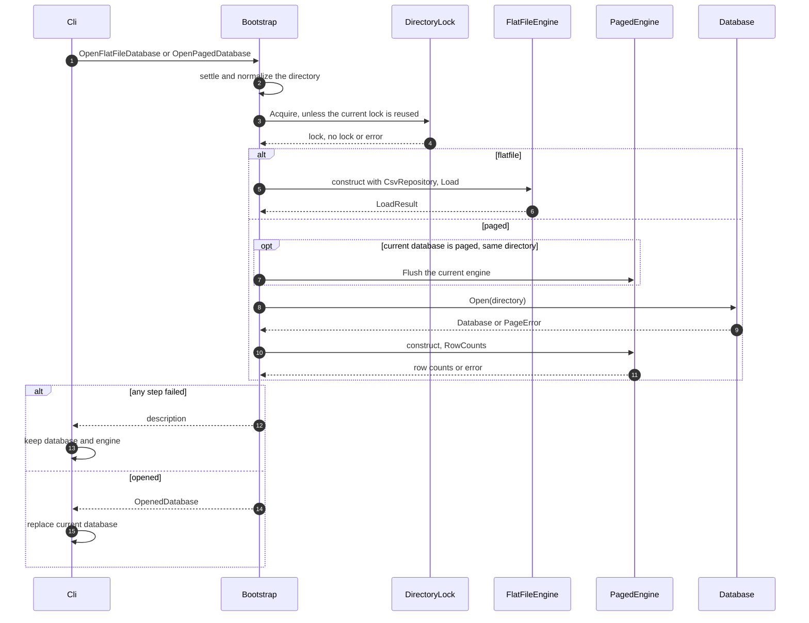

Steps 1 and 2: `Bootstrap` creates a missing directory whose parent exists, one level only (`is_created`), and normalizes the path; a missing parent is `no such directory`, a file is `not a directory`, and a failed creation is `cannot create directory`.

Steps 3 and 4: the lock of `current` is reused when the normalized path is the same and `current` holds a lock, since a second `Acquire` in one process would fail; otherwise, also after an open that took no lock, `Acquire` runs by 2.14, and a failure continues at step 12.

Steps 5 and 6: flatfile loads by 2.9, in parallel with `--parallel` (at most the hardware concurrency, same result), and registers the tables in catalog order.

Steps 7 to 11: on the same paged directory the current engine is flushed first (2.15). `Database::Open` then runs these open steps, and `RowCounts()` scans every table:

- Open steps 1 and 2: a missing directory or a file in its place is `kIo`; `paged.db` is opened for read and write, and created when missing.
- Open steps 3 and 4: a new file gets the three pages of 2.10 and a `FlushAll`.
- Open step 5: an existing file is checked, in order, for at least 3 pages, `magic`, `format_version`, `page_size`, the type of page 0, the header CRC and `page_id`, the system first pages within the file and a `next_table_id` of at least 3, reading page 0 directly from the store; a failed check is `kCorrupt` (2.15) and a failed read `kIo`.
- Open steps 6 and 7: `Catalog::Load` validates the system tables, the `index_root` of each table included (2.6).
- Open step 8: `PageAllocator::FreePages` walks the free list (2.10).
- Open step 9: on failure the objects already built are released and the file is left as it is; a file that this open created keeps what was written, and the next open judges it by the file rules of 2.15.

The index of a table is opened with its heap, on the first call of `Database::Table` or `Database::Index` for that table, which `RowCounts()` makes at open for every table:

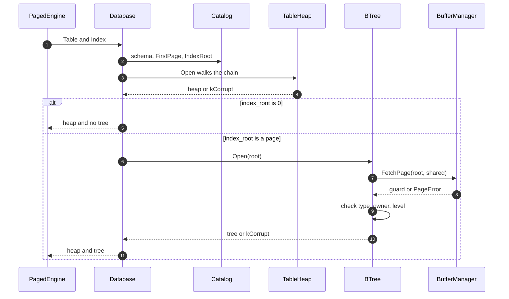

In this diagram, steps 2 to 4: `Catalog` returns the schema, the first page and the root from its cache (2.6), and the chain is walked as in 2.11. Step 5: a table without an index, one whose primary key is not an INT, gets no tree. Steps 6 to 11: `BTree::Open` fetches the root shared, releases it after the O(1) check of the node header (2.17, damaged nodes: page type, table, its own page id, the heap fields, a level of 40 or more and a `key_count` above the capacity), and returns `kCorrupt` for a root that fails it; nothing else of the tree is read, so a damaged node below the root is found by the operation that meets it or by `.dump index` (2.17, 3.7). Both objects are cached, and `AddColumn` and `DropTable` replace or erase them together (2.6).

Steps 12 and 13: a failure prints `error: could not open <directory>: <reason>` (3.7), with the directory as typed for `.open` and normalized for `.engine`, and releases the lock taken for the attempt.

Steps 14 and 15: `Cli` replaces the old database, which writes out its pages if paged, and prints `created new database <directory>` or the `loaded` line with each table's row count (`loaded no tables` when empty). On flatfile a table with rejected rows adds ` (rejected <n>)` and a line `<table>.csv: rejected lines <n>, ...` with at most 10 numbers, ending in `, ...` when there are more; `created new database` shows the directory as entered.

### 3.2 Flow: Execute a Query

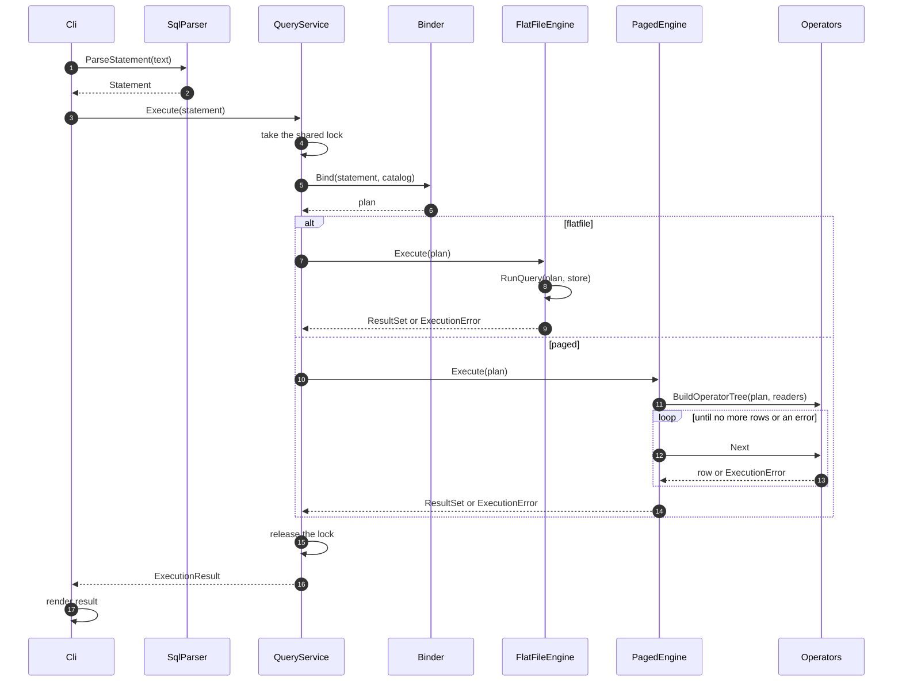

Steps 1 and 2: parsing needs no catalog, and a `ParseError` ends the flow. Steps 3 to 6: `QueryService` takes the shared lock (2.14) and binds by 2.4; a bind error returns at once. Steps 7 to 9: `RunQuery` computes the plan over the tables in memory (2.9). Steps 10 to 14: `PagedEngine` builds the operator tree and pulls the root until the end or the first error (2.13), each scan fetching pages through the buffer pool (2.12); `readers` are the `ITableReader` and the `IIndexReader`, and a filter on a key range of an indexed table reads through the second (3.9). Steps 15 to 17: the lock is released, and `Cli` prints the result (3.6).

### 3.3 Flow: Execute a Write Statement

`INSERT`, `UPDATE` and `DELETE` compute and check the change with a pure function, persist it, and only then report success. The paged example is `UPDATE visitors SET username = 'x' WHERE id = 1`, which cascades.

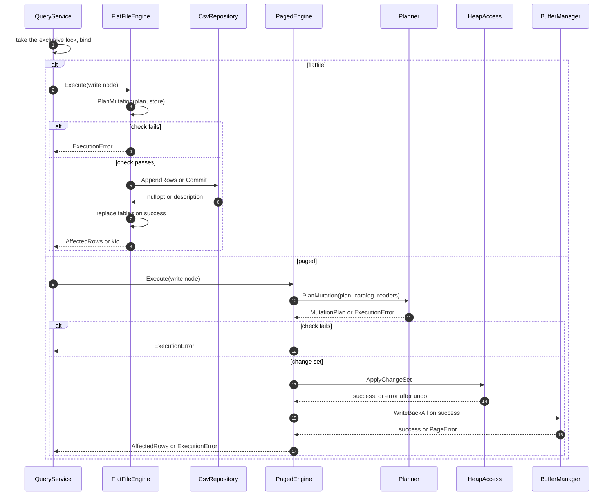

Step 1: the exclusive lock is taken before binding (2.14). Steps 2 to 4: `PlanMutation` checks by 2.5 and computes the rows to append or the changed tables; a failure changes nothing. Steps 5 to 8: `INSERT` uses one `AppendRows`, and `UPDATE` and `DELETE` one `Commit` (commit steps below) of every changed table, so a cascade succeeds or fails as a whole (ADR-0008); memory changes only after the write, and a statement that changes nothing skips it. Steps 9 to 12: `PlanMutation` reads through `ITableReader` and, for a table with an index, through `IIndexReader` (2.13). Steps 13 to 17: `ApplyChangeSet` applies, or undoes and returns the error; only a complete apply is written out by `WriteBackAll`, and a failed write-out is reported by 2.15. An empty change set skips steps 13 to 16. Each `TableHeap::Insert` takes the page that the free-space map names, latching the tail and then a new page when it must grow the chain (2.11). For a table with an index, `ApplyChangeSet` follows each heap step with the index step of 3.8 or 3.10, and a query with a key range reads as in 3.9.

The staged commit of `Commit` writes `catalog.csv` (when `CommitSet::catalog` has a value) and the tables of `writes` and `drops` through temporary files:

- Commit steps 1 and 2: it checks, in order, its arguments (no table twice, none named `catalog`), that no target changed since it was recorded, and then per target that no `.orig` is left over, that a new file is absent, that an existing one is a regular file the owner can write (2.9), and that no `<file>.temp` is a symbolic link, because the write of step 3 would follow it into another file; a failure writes nothing and names the file (`not a regular file: <file>.temp` for a link).
- Commit steps 3 and 4: each new content goes to `<file>.temp` with the original's permissions; a failed write removes every `.temp` and returns `could not write <file>`.
- Commit steps 5 and 6: in the order `catalog.csv`, `writes`, `drops`, each original becomes `<file>.orig` and each `.temp` takes its name. A failed rename renames every `.orig` back, removes the remaining `.temp` and newly created files and returns `could not write <file>`; a failed restore still restores the others and returns the first one as `restore failed: <file>.orig holds the original`.
- Commit step 7: the `.orig` files are removed, with the data of dropped tables. A failed removal keeps the success, but the `.orig` fails the next load and blocks every later write to that file (2.9, 2.15).

### 3.4 Flow: Execute a DDL Statement

`CREATE TABLE`, `ALTER TABLE ADD COLUMN` and `DROP TABLE` are bound under the exclusive lock by 2.4, and the engines differ by 2.6.

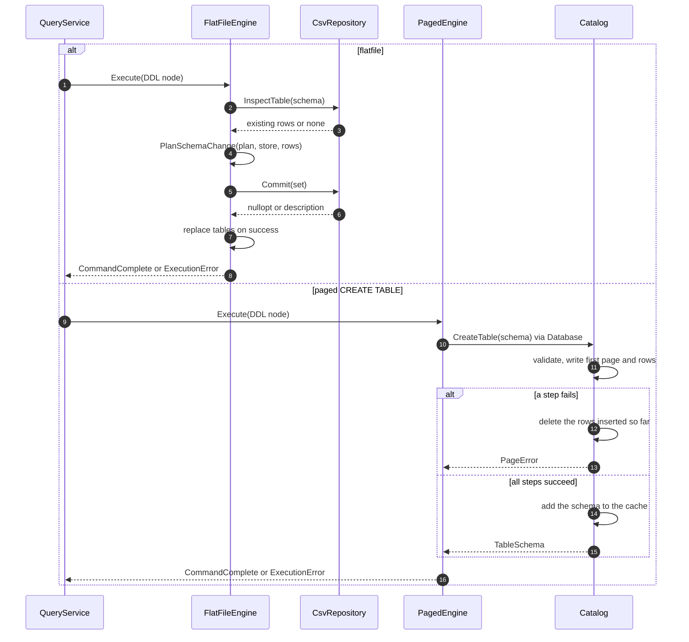

Steps 1 to 3: only `CREATE TABLE` calls `InspectTable`, and not for a table already registered, so the record taken at load stays and the result is `table <table> already exists`; a failed inspection is `kIo`. Step 4: `PlanSchemaChange` checks existence, each TEXT `DEFAULT` (2.9) and the adoption rules (2.6), or fills the default into every row. Steps 5 and 6: one `Commit` (commit steps of 3.3) sets the new `catalog`; a create writes the new table as `is_new_file` (an adopted CSV is not rewritten), an add column regenerates the header, and a drop lists the table in `drops` (ADR-0008). Steps 7 and 8: memory changes after the commit, and the tag is `CREATE TABLE <table>` (`(adopted <n> rows)` on adoption), `ALTER TABLE <table>` or `DROP TABLE <table>`.

Steps 9 and 10: the diagram shows `CREATE TABLE` on paged, and `ALTER TABLE` and `DROP TABLE` follow the second diagram; `Database::CreateTable` returns `kClosed` after `Close`. Step 11: the creation checks of 2.6 run, then the first page, the root page of the index when the primary key is an INT, the `sys_tables` row, one `sys_columns` row per column and the new `next_table_id` are written. Steps 12 and 13: on failure the rows written are deleted, best-effort, and the error ends with `; undoing the rows also failed: <message>` when that fails too; pages are not reclaimed. Steps 14 to 16: the cache changes only on success, and the pages are written out as after a write (3.3).

`ALTER TABLE ADD COLUMN` and `DROP TABLE` on paged work on the page chain of the table, which the second diagram shows. `Database` is the only caller of `Catalog`'s two changes and of `PageAllocator::Release`.

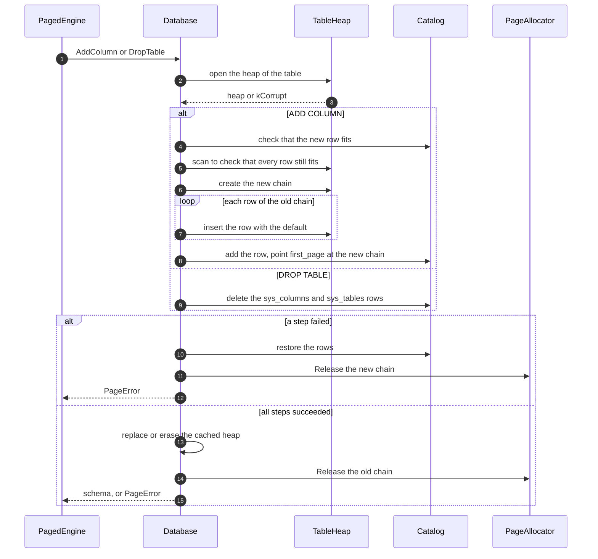

Steps 1 to 3: the heap of the table is opened first, so a corrupt chain fails the statement before anything changes, as `kCorrupt`. Steps 4 and 5: `ADD COLUMN` checks that the new `sys_columns` row fits in a tuple and that every row still fits in 4060 bytes with the default appended, and a failed check ends the statement with no page written. Steps 6 and 7: it builds the new chain with the extended schema and inserts each row of the old chain with the default appended. Step 8: only then does it write the `sys_columns` row and change `first_page`, so the old chain stays whole until the last write. Step 9: `DROP TABLE` deletes the `sys_columns` rows of the table and then its `sys_tables` row. Steps 10 to 12: after a failed step, the row added by `ADD COLUMN` is deleted, the rows removed by `DROP TABLE` are inserted again, and the new chain of `ADD COLUMN` goes back to the free list, all best-effort, and the error ends with `; undoing the rows also failed: <message>` or `; releasing the new pages also failed: <message>` when that fails too. Steps 13 to 15: on success the catalog cache and the cached heap change, the old chain (the dropped one, for `DROP TABLE`) is released, and a failed release is `kIo` `<message>; statement was applied but its pages were not reclaimed`, which leaves pages that nothing owns and the dirty pages in the pool until the next write-out. After a success the pages are written out as after a write (3.3).

For a table with an index the same steps cover the index (ADR-0053, ADR-0054). Step 6 also creates the root of a new tree, and in step 7 each copied row also inserts its key with its new `Rid` into it. In step 8 one row update changes `first_page` and `index_root`. In steps 10 to 12 the new tree is released with the new chain, and in steps 13 to 15 the old tree is released with the old chain, as one `ReleasePages` list for the tree and one `Release` for the chain. Both statements list the pages of the old tree by `BTree::Pages` before they change anything (after the check of the new `sys_columns` row in step 4 and before the first page changes for `ADD COLUMN`, before step 9 for `DROP TABLE`), so a corrupt tree fails the statement before a row is deleted or a page is allocated.

### 3.5 Flow: Import a CSV

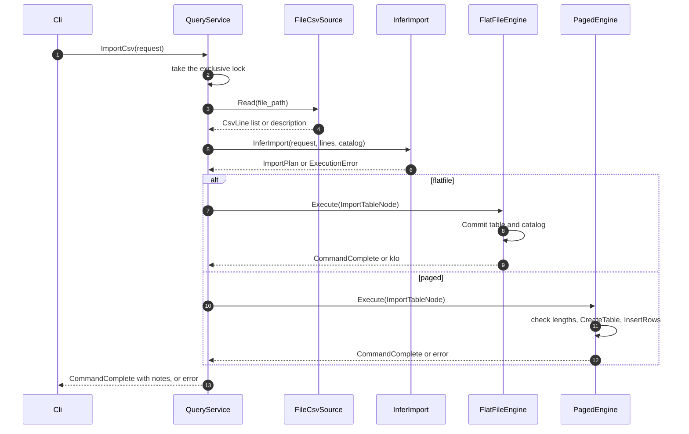

Steps 1 to 4: the exclusive lock comes first (2.14), and an unreadable file is `kIo`. Steps 5 and 6: `InferImport` applies 2.7 or returns `kBind`. Steps 7 to 9: flatfile commits `<table>.csv` (`is_new_file`) and `catalog.csv` together (commit steps of 3.3) and registers the table after success. Steps 10 to 12: paged writes by 2.7 and writes the pages out (3.3). Step 13: the tag carries the skipped count and the notes their reasons (ADR-0021).

### 3.6 Interface

`strata_cli [<directory> [--parallel]]` reads `stdin` until the end and exits with 0; the directory is opened first (a failure is printed and reading continues), and wrong arguments print `usage: strata_cli [<directory> [--parallel]]` to `stderr` and exit with 2: more than two arguments, a second argument other than `--parallel`, and a first argument that starts with `-` (ADR-0059), so a directory whose name starts with `-` is given as `./-name`. When no statement is in progress, a line starting with a command name is a command; everything else is a statement that ends at a `;` outside a string literal, may span lines (joined with `\n`) and may share a line with others (ADR-0017). The open check runs after parsing, so before `.open` a syntax error still prints as one. Input ending inside a statement prints `error: incomplete statement at end of input`, and a syntax error prints `syntax error at column <n>: <description>`, or `syntax error at line <l>, column <c>: <description>` past the first line of a statement. Input tolerance (ADR-0023): when no statement is in progress, a command name without `.` (`open`, `engine`, `import`, `tables`, `schema`, `dump`, `help`, `quit`, `exit`, `clear`, `cancel`) prints `error: commands start with '.'; did you mean .<name>` and discards the line; a line that starts with `.` but names no command prints `error: unknown command .<name>; .help lists the commands` and discards the line, so a mistyped command cannot absorb the statements that follow it; a full-width `；` outside literals and comments prints `error: full-width ';' (U+FF1B) found; use ASCII ';'` and discards the line, keeping the statement text of earlier lines; comments, extra whitespace and empty statements are skipped.

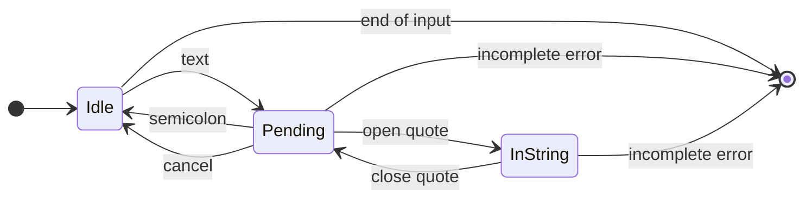

`Pending` holds an unfinished statement and `InString` an open string literal; `.cancel` discards `Pending` and prints nothing. On a terminal the prompts are `strata> `, `   ...> ` and `     '> `, all 8 characters wide, and a pipe gets none.

The commands are `.open <directory> [--parallel]`, `.engine [flatfile|paged]` (the setting starts as `flatfile` and lasts one session, ADR-0041; another name prints its usage, and a failed switch prints no `engine` line), `.tables`, `.schema [<table>]` (re-executable `CREATE TABLE` statements, one line per column with `PRIMARY KEY [AUTOINCREMENT]`, `UNIQUE`, `DEFAULT` and `REFERENCES` in that order, whose replay gives the same text, ADR-0018), `.dump index <table>` (the shape and the check of an index, below), `.import` (2.7), `.clear`, `.cancel`, `.help` (the commands, then two lines: statements end with `;`, and `NOT NULL` has no effect) and `.quit` or `.exit`. `.tables`, `.schema`, `.dump` and `.import` need an open database, and extra arguments, or an `.open` directory that starts with `--`, print `syntax error at column 1: usage: <usage>`. A command splits its line at whitespace, so the directory of `.open` and the paths of `.import` cannot contain whitespace; `.open /tmp/My Docs/db` prints the usage, and the workaround is a path without a space. An open that finds no table of its own engine but the file of the other one adds `note: this directory also has a paged database (paged.db); .engine paged opens it` or `note: this directory also has a flatfile catalog (catalog.csv); .engine flatfile opens it`.

The examples run on a copy of `sample_my_db/` whose `students.csv` has three added lines that the schema rejects (ET-01); the import and the index example run in new directories.

`.dump index <table>` calls `QueryService::DescribeIndex` and prints the first line `index <table>(<column>): height <h>, nodes <n>, keys <k>`; then one line per node in breadth-first order from the root, `level <l> page <p> keys <c> [<first> .. <last>]` with ` next <p>` on a leaf that has a right sibling and no bracket on an empty node, at most 40 lines, then `... and <m> more nodes` when there are more; and a last line `check: ok` or `check: <the first violation>`. When the walk stops at a damaged node, the first line counts only the nodes read up to it, and the check line names the violation. A table without an index is `error: bind: table <table> has no index`, an unknown table is `error: no such table: <table>`, flatfile is `error: unsupported: the flatfile engine has no indexes`, and wrong arguments are `syntax error at column 1: usage: .dump index <table>`.

| Action | Operation | Command or statement | Expected output |
|---|---|---|---|
| Connect | `OpenFlatFileDatabase` | `.open sample_my_db --parallel` | `loaded instructors=6 students=30 (rejected 3) courses=12 enrollments=144`, `students.csv: rejected lines 12, 17, 18` |
| Connect with mismatched arguments | `Cli` | `.open` | `syntax error at column 1: usage: .open <directory> [--parallel]` |
| Connection held by another process | `OpenFlatFileDatabase` | `.open sample_my_db` while another process has it | `error: could not open sample_my_db: database is locked by another process` |
| List the tables | `QueryService::DescribeCatalog` | `.tables` | `instructors`, `students`, `courses`, `enrollments` |
| Show a table definition | `QueryService::DescribeCatalog` | `.schema students` | `CREATE TABLE students (`, one line per column, `);` |
| Import a CSV | `QueryService::ImportCsv` | `.open demo`, then `.import sample_my_db/students.csv students --pk id --type id=INT --skip-bad-rows` | `OK IMPORT students (imported 30 rows, skipped 3)` and three `skipped line` lines |
| Create, alter and drop | `QueryService::Execute` | `CREATE TABLE notes (id INTEGER PRIMARY KEY AUTOINCREMENT, body TEXT);`, `ALTER TABLE notes ADD COLUMN pinned INT DEFAULT 0;`, `DROP TABLE notes;` | `OK CREATE TABLE notes`, `OK ALTER TABLE notes`, `OK DROP TABLE notes` |
| Query | `QueryService::Execute` | `SELECT name, major FROM students WHERE id = 1001;` | `name<Tab>major`, `Alice Johnson<Tab>ART` |
| Insert, update, delete | `QueryService::Execute` | `INSERT INTO enrollments (student_id, course_id, semester) VALUES (1002, 1, '2026-Spring');`, `UPDATE courses SET capacity = capacity + 1 WHERE id = 1;`, `DELETE FROM enrollments WHERE id = 145;` | `OK affected=1` for each |
| Multi-row insert | `QueryService::Execute` | `INSERT INTO notes (body) VALUES ('a'), ('b'), ('c');` | `OK affected=3` |
| Delete a referenced row | `QueryService::Execute` | `DELETE FROM students WHERE id = 1001;` | `error: constraint violation: students.id=1001 is referenced by enrollments.student_id` |
| Join of three tables | `QueryService::Execute` | `SELECT s.name, COUNT(*) FROM students s JOIN enrollments e ON e.student_id = s.id JOIN courses c ON e.course_id = c.id WHERE s.id = 1005 GROUP BY s.name;` | `name<Tab>COUNT(*)`, `Emma Brown<Tab>6` |
| Switch engine | `OpenPagedDatabase` | `.engine paged` after `.open sample_my_db` | `engine paged`, `loaded no tables`, the `note:` line |
| Concurrent statements | `QueryService::Execute` | Several threads at once | Each result equals the statement run alone |
| Show an index | `QueryService::DescribeIndex` | `.engine paged`, `.open demo_paged`, `CREATE TABLE notes (id INTEGER PRIMARY KEY AUTOINCREMENT, body TEXT);`, `INSERT INTO notes (body) VALUES ('a'), ('b'), ('c');`, `.dump index notes` | `index notes(id): height 1, nodes 1, keys 3`, `level 0 page 4 keys 3 [1 .. 3]`, `check: ok` |
| Compare with SQLite | `tests/differential/differential.py` | `python3 -I tests/differential/differential.py --cli build/strata_cli` | `differential: <n> statements, <e> expected differences, 0 unexpected`, and exit status 0 |
| Run the comparison under CTest | `add_test` in `CMakeLists.txt` (ADR-0057) | `ctest --test-dir build -R differential --output-on-failure` | `100% tests passed, 0 tests failed out of 2` (the tests `differential` and `differential_unit`), or, when no Python 3.10 or later is found, no test and the line `Python3 not found: the differential tests are not registered` at configure time |
| Help, clear, cancel, quit | `Cli` | `.help`, `.clear`, `.cancel`, `.quit` or `.exit` | The command list and the two notes; the control codes that clear the terminal; nothing, with the pending statement discarded; exit with status 0 |

The comparison command prints each unexpected difference and exits with 1 when the three systems disagree in a way that the corpus does not mark (ADR-0047).

Output forms: a `ResultSet` prints the column names and then the rows, separated by Tab; `AffectedRows` prints `OK affected=<n>`, `CommandComplete` prints `OK <tag>` and its notes, and an error prints `error: <kind>: <message>` with `<kind>` one of `bind`, `unsupported`, `constraint violation`, `runtime` and `io`. Shared state lives only in the database directory; the engine setting and the DB-level lock are process memory. The terminal prompt and line editing cannot be checked headless, and lock fairness is not measured.

### 3.7 Failure Paths

This table and the messages of section 2 are the contract; other descriptions fix only the error kind and the identifiers. Where `Detected by` names two components separated by `;`, the first is flatfile's and the second paged's.

| Failure | Detected by | Output | State guarantee |
|---|---|---|---|
| Syntax error, mismatched arguments, command without `.`, unknown command, full-width `；`, incomplete input | `SqlParser`, `Cli`, `main` | The messages of 3.6 | No change; a syntax error discards its statement, and a command without `.`, an unknown command or a full-width `；` its line |
| Statement before `.open`, `.schema` of a missing table | `Cli` | `error: no database open; run .open first`, `error: no such table: <table>` | No change |
| Name, type or DDL error; `UPDATE` of a primary key | `Binder` | `error: bind: ...` or `error: unsupported: ...` (2.4) | No change |
| A row or DDL the engine cannot handle | `FlatFileEngine`; `PlanMutation`, `PagedEngine` | `error: unsupported: ...` (2.5, 2.6) | No change |
| Constraint violation, including adoption | `FlatFileEngine`; `PlanMutation` | `error: constraint violation: ...` (2.5, 2.6) | No change |
| Runtime error | `Binder`, then the engine | `error: runtime: ...` (2.3) | No change |
| `.import` check, unreadable source | `InferImport`, `FileCsvSource` | `error: bind: ...` (2.7), `error: io: cannot read <path>` | No change |
| CSV write, target check, adoption read or external change | `CsvRepository` | `error: io: ...` (2.9, 3.3) | Unchanged, except after a failed restore or truncation |
| Read error or corrupt page | `HeapRowStream` | `error: io: ...` (2.13) | No change; other tables unaffected |
| Apply failure, index steps included | `ApplyChangeSet` | `error: io: ...` (2.13) | Undone, heap and index together, unless the undo also fails |
| Damaged index: a bad root, a node that fails its checks, an entry that names no row or another row | `BTree`, `HeapRowStream` | `error: io: corrupt: ...` (2.13, 2.17) | No change. A bad root fails `.open`, because `RowCounts()` opens every index (3.1); other damage fails only the operation that meets it, and the other tables are unaffected |
| `.dump index` of a table without an index, an unknown table, or on flatfile | `QueryService`, `Cli` | `error: bind: ...`, `error: no such table: <table>`, `error: unsupported: ...` (3.6) | No change |
| `.import` failing midway on paged | `PagedEngine` | 2.7 | An empty table remains |
| `ALTER TABLE` or `DROP TABLE` failing on paged | `Database` | `error: io: ...`, with the endings of 3.4 | The table is as before when the failure comes before the last write; after it the statement is applied, and pages that nothing owns can remain |
| Write-out failure | `PagedEngine` | 2.15 | Applied in memory; some pages may be on disk |
| `.open` or `.engine` cannot open | `Bootstrap` | `error: could not open <directory>: <reason>`, with the reasons of 3.1, 2.14, 2.15, `cannot create .strata.lock: <reason>`, `cannot lock .strata.lock: <reason>`, `leftover <file>.orig`, `cannot read catalog.csv`, `invalid catalog.csv: <detail>`, `cannot read <table>.csv` or `header of <table>.csv does not match the catalog` | The current database and setting stay |
| A replaced paged database cannot be written | `Database::~Database` | `paged: failed to write the database on destruction: <message>` | The new database is open; unsaved statements are lost |

### 3.8 Flow: Insert a Row into an Index

`INSERT` into a table with an index, or the re-insertion of a row by an undo, runs the heap step and then the index step in the helper of 2.13. The diagram shows the index step, with a split.

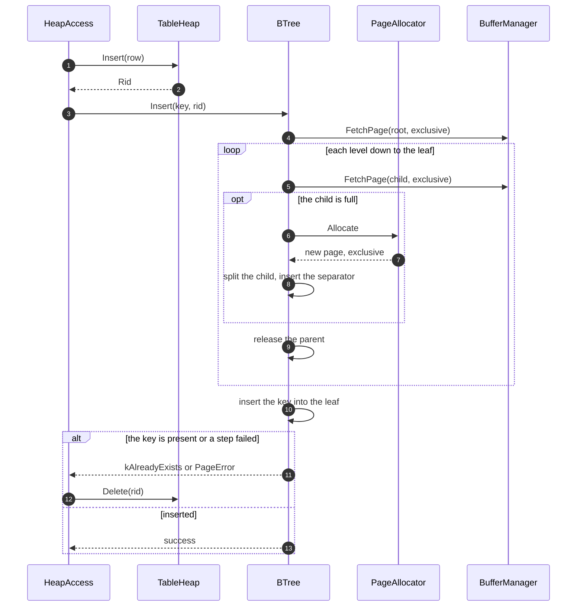

1. Steps 1 and 2: the row goes into the heap first, because the index entry needs its `Rid` (2.11).
2. Steps 3 and 4: `BTree::Insert` takes the exclusive latch of the root. A full root is split in place before step 5: two `Allocate` calls as in steps 6 and 7, with no new page held at the second call, two new pages for its halves, and the root page, which keeps its page id, becomes an internal node of one key (2.17).
3. Steps 5 to 9: for each level the writer latches the child exclusively. A full child gets a new right sibling from `Allocate`, which latches the file header and then the page (steps 6 and 7), and the child is split into it with the separator written into the parent, which has room because a full node is split on the way down (step 8). The latch of the parent is released at step 9, so inside `Allocate` (steps 6 and 7) the writer holds the parent, the child, the file header and a page taken from the free list, four latches in the order of 2.17, the peak; when the free list is empty `Allocate` lets go of the header before it extends the file, so the peak is three, and it is three in both cases once `Allocate` has returned.
4. Step 10: the leaf is not full, so `LeafSearch` and `LeafInsertAt` place the key; a key that is already there is `kAlreadyExists`, which the planner has already excluded by the duplicate check of 2.5.
5. Steps 11 and 12: on an error the helper deletes the row it just inserted, so heap and index stay in step (2.13). The fetches and `Allocate` are the only steps that can fail and come before the nodes they concern change, so the tree stays valid (2.17).
6. Step 13: success is returned, and `Inserted(rid)` is recorded for the undo.

### 3.9 Flow: Scan an Index

A query whose `WHERE` holds a key range on the indexed column reads through the index (2.13). Building the operator tree reads no page; the first `Next` does.

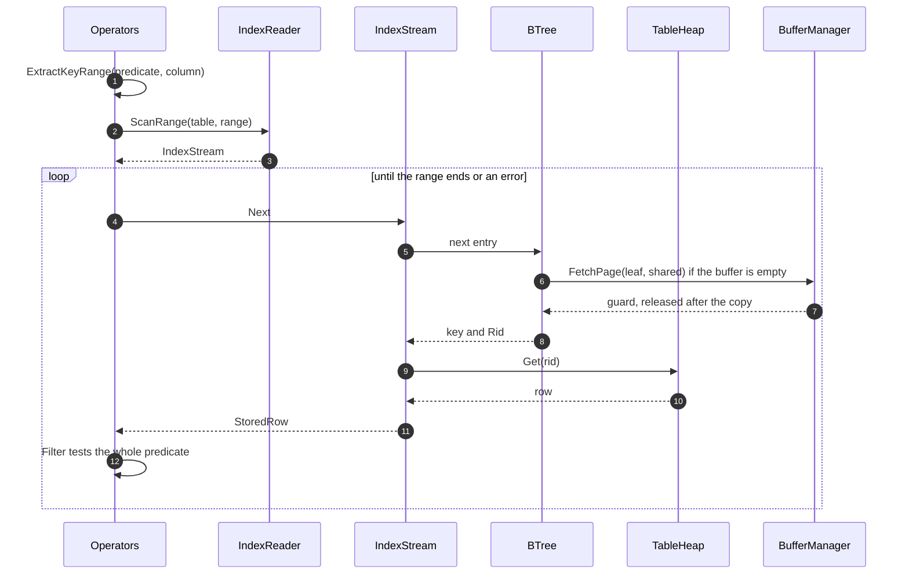

1. Steps 1 to 3: the builder extracts the range with the pure function of 2.13. With no range it reads through `ITableReader::Scan` and this flow does not apply. `ScanRange` returns the stream and reads nothing.
2. Steps 4 to 8: on the first `Next` the stream descends with shared latches, each child latched before the parent is released, to the leaf of the low bound, and copies the entries of the range of that leaf; on later calls it fetches the next leaf by `next_page_id` only when its buffer is empty. Each latch is released as soon as the entries are copied, so no pin is held between two `Next` calls, and the entries come in ascending key order (2.17).
3. Steps 9 to 11: the row of each entry is read by `TableHeap::Get`, one page at a time. An entry whose `Rid` names no live row, or a row whose key differs from the entry, is `kCorrupt` (3.7).
4. Step 12: the filter above the scan still tests the whole predicate, so the rows that pass are those of a full scan (ADR-0052). The loop ends at the first key above the high bound, at the end of the leaf chain, after the leaf of the low bound when the high bound is below the separator that bounds that leaf (2.17), or at an error, which ends the stream (2.13).

### 3.10 Flow: Delete a Key from an Index

A `DELETE`, the delete half of an update that moves a row, and the undo of an insert remove a key. The delete is lazy: only the key leaves its leaf.

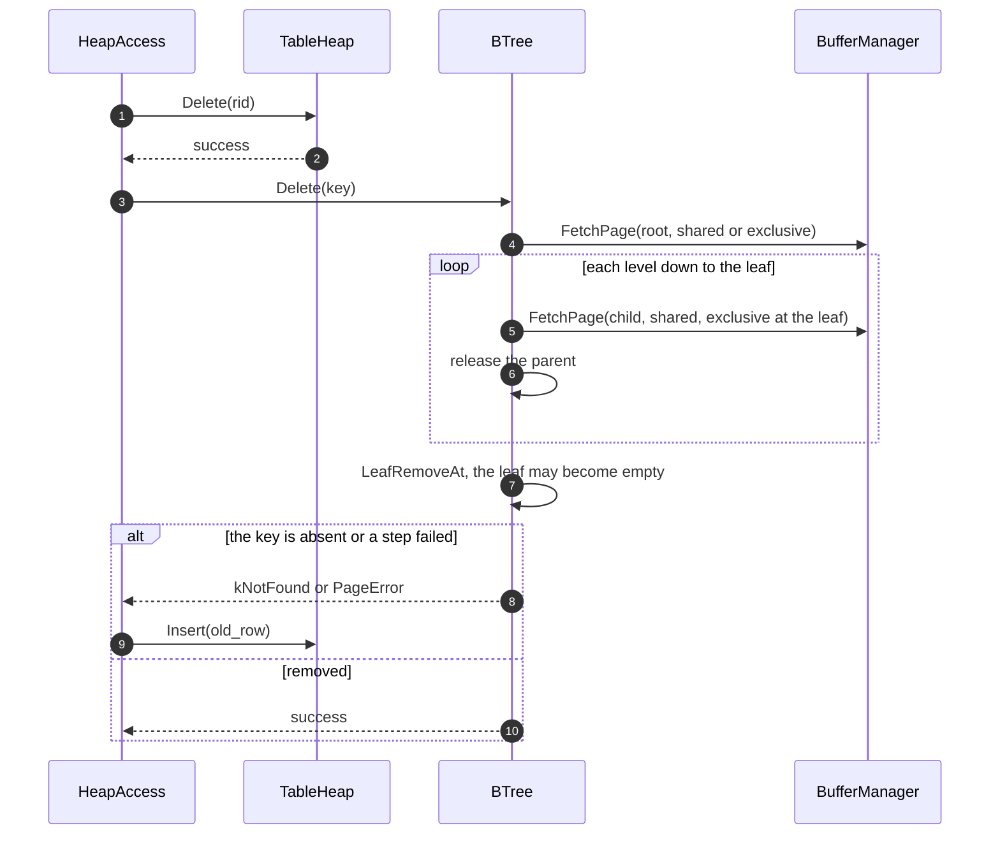

1. Steps 1 and 2: the row leaves the heap first, as in 2.13.
2. Steps 3 to 6: `BTree::Delete` descends with shared latches and takes the exclusive latch of the leaf only, because a delete does not change the structure (2.17). The level of the node being left says whether the child is a leaf, and a root that is a leaf is latched shared and then exclusively at step 4 (2.17). Each child is latched before its parent is released, so the last parent is released once the leaf is latched.
3. Step 7: `LeafRemoveAt` removes the key and closes the gap. A leaf that becomes empty stays in the tree and in the leaf chain, and a range scan skips it. No node is merged, redistributed or freed, the height does not fall and the separators of the parents stay valid.
4. Steps 8 and 9: when the key is absent the index disagrees with the heap, and the helper inserts the old row again, which gets a new `Rid`, leaves the missing key missing and reports `corrupt: index of <table> has no entry for key <key>`; after an I/O failure, where the key is still in the index, the same undo points the key at the new `Rid` (2.13).
5. Step 10: success is returned, and `Deleted(old_row)` is recorded for the undo.

## 4. Decisions

The decisions are recorded in [DecisionRecord.md](DecisionRecord.md): ADR-0001, ADR-0002, ADR-0003, ADR-0004, ADR-0005, ADR-0006, ADR-0007, ADR-0008, ADR-0009, ADR-0010, ADR-0011, ADR-0012, ADR-0013, ADR-0014, ADR-0015, ADR-0016, ADR-0017, ADR-0018, ADR-0019, ADR-0020, ADR-0021, ADR-0022, ADR-0023, ADR-0024, ADR-0025, ADR-0026, ADR-0027, ADR-0028, ADR-0029, ADR-0030, ADR-0031, ADR-0032, ADR-0033, ADR-0034, ADR-0035, ADR-0036, ADR-0037, ADR-0038, ADR-0039, ADR-0040, ADR-0041, ADR-0042, ADR-0043, ADR-0044, ADR-0045, ADR-0046, ADR-0047, ADR-0048, ADR-0049, ADR-0050, ADR-0051, ADR-0052, ADR-0053, ADR-0054, ADR-0055, ADR-0056, ADR-0057, ADR-0058, ADR-0059.

## 5. Testing

### 5.1 Verification Approach

Pure components are checked by table-driven cases and the ports by fakes that inject failures, while both engines, `Bootstrap` and `strata_cli` run on files in a temporary directory, with concurrent readers and a writer also under ThreadSanitizer. Both engines run the same statement sequences and are compared by 2.8, with the timings of the two engines printed. The volume tests generate their data from fixed word lists and a fixed pseudo-random sequence, so every run reads the same rows and no test depends on a file outside the repository. A Python harness that CTest runs and the build does not compile runs one statement corpus on SQLite and on both engines of `strata_cli`, one process per statement, so each paged statement reads the file that the previous one wrote (ADR-0047, ADR-0057). The B+Tree is checked at three levels: the node functions and the invariant checker by table-driven cases over hand-built pages, the tree by random operations against `std::map` with failure injection and by a writer beside readers under ThreadSanitizer, and the use of the index by comparing every indexed statement with the same statement run as a full scan. The test plan is in [TestDocument.md](TestDocument.md).

## 6. References

- **Graefe, "Volcano - An Extensible and Parallel Query Evaluation System" (IEEE TKDE, 1994):** the pull-based operator model of ADR-0036 and 2.13, with open folded into the first `Next` and no close.
- **Johnson and Shasha, "2Q" (VLDB 1994):** the A1in, A1out and Am queues of ADR-0029 and 2.12, simplified to 1/4 and 1/2.
- **RFC 3720, CRC-32C:** the checksum polynomial of ADR-0025 and 2.10; the CRC of `"123456789"` is `0xE3069283`.
- **Apple `fsync(2)` and `F_FULLFSYNC`:** why 2.15 syncs with `F_FULLFSYNC` on macOS.
- **Bayer and McCreight, "Organization and Maintenance of Large Ordered Indexes" (Acta Informatica, 1972), and Comer, "The Ubiquitous B-Tree" (ACM Computing Surveys, 1979):** the B+Tree of 2.17, with keys and Rids in the leaves and separators above.
- **Cormen, Leiserson, Rivest and Stein, "Introduction to Algorithms", chapter on B-trees:** the split of a full node on the way down, which ADR-0050 adopts so that the number of held latches does not grow with the height.
- **SQLite, "Database File Format", table b-trees:** the root page that keeps its page number when it splits, which ADR-0050 and ADR-0048 follow so that the catalog row does not change on a root split.
- **SQLite, "Database File Format", the freelist:** the model of ADR-0046, a first-free-page field in the file header and a list threaded through the free pages; Strata links every page of a dropped table instead of using trunk pages, and types a free page so that a page cannot be free and owned at once.
